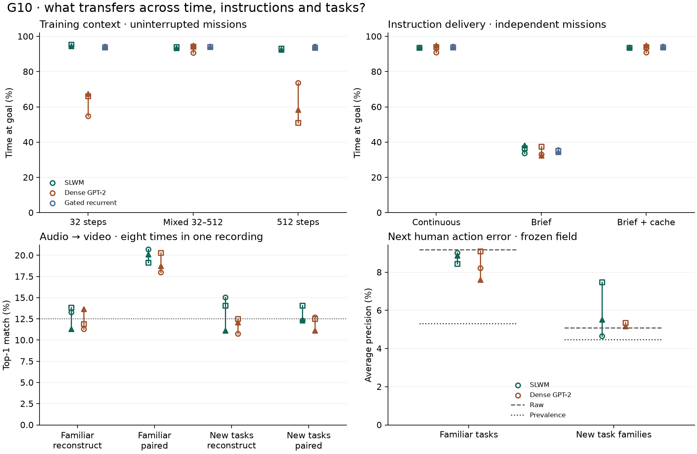

# G10 · shared state under longer histories and new physical tasks

Matched variable-context training changes the conclusion from G9. At equal training exposure, SLWM led dense GPT-2 in **one of three** seeds on uninterrupted held control. The simpler gated recurrent reference handled two actuator changes better than the hybrid in every seed. On public human task recordings, synchronous audio–video supervision yielded 20.7 / 19.1 / 20.1% audio-to-video accuracy for SLWM on familiar task families, and 12.3 / 14.1 / 12.3% on held coffee/computer tasks. Chance was 12.5%. Neither architecture met the prespecified novel-task alignment criterion.

Points represent three independent training seeds. The dotted retrieval reference is chance among eight time windows in the same recording. All controller policies issue an action and receive its consequences for 512 consecutive ticks.

## What originally looked like an architecture win?

Within each training seed, every architecture saw the same 41,943,040 clock positions, 61,440 independently initialized simulated worlds, public room data, source masks, commands and action targets. Each core had 13,245,696 parameters and emitted 128 coordinates. The primary cohort contained 256 fresh 51.2-second missions with unpredictable goal intervals and held motor stalls. Time at the requested goal was 54.7 / 66.2 / 67.5% for dense GPT-2 trained in 32-step segments, 90.8 / 94.2 / 94.9% with variable 32–512 histories, and 73.6 / 51.1 / 58.3% with only 512-step histories. The corresponding variable-context outcomes for SLWM and the gated reference were 93.7 / 94.0 / 93.4% and 94.3 / 94.0 / 94.0%. All intervals are paired within training seed. [Full factorial, actuator changes and calibration-delay controls](context.md)

Variable training changes how often the model begins a new context, how far gradients traverse and how many available past observations compete for attention. The experiment identifies the effect of the segmentation schedule as a whole. The dense control used the common periodic clock inherited from G9. A separately tuned Transformer with a distinct long-range position scheme is a further comparison.

## Does sustained control mean remembering what the user said?

Showing a goal for 0.4 seconds instead of continuously reduced hybrid occupancy by **59.7 / 57.4 / 54.8 points**. The dense loss was **57.3 / 54.4 / 60.7 points**. Twelve matched post-training fits did not repair this consistently. Holding the last actually received word record until superseded reproduced every action of continuous delivery across nine frozen models and 256 further missions each. This is an explicit, inspectable goal memory for the simulator's structured instructions. [Causal cache, fresh-cohort tuning and limits](commands.md)

## Do real signals meet in the same coordinates?

We used up to ten minutes per session, totaling 29.48 hours from **416 public HoloAssist sessions** with video, pitch-shifted microphone audio, synchronized accelerometer and gyroscope readings, completed spoken utterances and human correctness labels. The optimization split contained 256 recordings, 19.15 hours and 34,423 transcribed words. Development had 32 separate recordings. The 64 familiar-task tests were drawn from official validation. The 64 novel-task recordings belonged to coffee-machine or computer tasks absent from optimization and development. Grouping avoids repeated source sessions. People may recur across recordings. [Original public dataset](https://holoassist.github.io/) · [Split, hashes and source exposure](metrics/data.json)

Each post-training update rehearsed 4,096 simulated clock positions and drew 2,048 real positions. In the mixed treatment half the real candidate groups came from STARSS23 and half from HoloAssist. Audio-only and camera-only views of a synchronously recorded window are additional views of the same information. Only 21.6 / 21.0 / 21.6% of sampled HoloAssist clock positions combined a four-source mask, a recently completed utterance and fresh IMU samples. The compressed-video release omitted the audio track. We verified the audio tracks in the separate original AV members before training.

The fixed-temperature contrastive loss reads the full emitted field. Eight candidate windows belong to the same recording, share the same relative clock, and start in disjoint intervals. The shifted treatment substitutes a nonzero random cyclic permutation of the targets. The reconstruction treatment has zero contrastive weight. The room-only control retains genuine pairing and the same optimizer exposure while sourcing all of its real groups from STARSS23. All sensor decoders continue to read the same world field.

| Core | Post-training | Familiar HoloAssist (%) | Held task families (%) | Sony rooms 21/22 (%) |
| --- | --- | ---: | ---: | ---: |
| SLWM | reconstruct | 13.3 / 13.9 / 11.3 | 15.0 / 14.1 / 11.1 | 13.4 / 10.3 / 11.6 |
| SLWM | shifted | 11.3 / 11.9 / 14.1 | 11.9 / 10.9 / 14.8 | 14.3 / 11.6 / 10.7 |
| SLWM | paired | 20.7 / 19.1 / 20.1 | 12.3 / 14.1 / 12.3 | 10.7 / 12.5 / 16.5 |
| SLWM | rooms | 11.7 / 14.1 / 11.9 | 11.9 / 13.9 / 7.6 | 14.3 / 15.2 / 12.9 |
| Dense GPT-2 | reconstruct | 11.3 / 11.9 / 13.7 | 10.7 / 12.5 / 12.1 | 12.1 / 16.1 / 12.1 |
| Dense GPT-2 | shifted | 10.5 / 11.1 / 9.8 | 13.1 / 11.3 / 11.3 | 16.1 / 15.6 / 16.5 |
| Dense GPT-2 | paired | 18.0 / 20.3 / 18.8 | 12.7 / 12.5 / 11.1 | 12.5 / 9.4 / 14.7 |
| Dense GPT-2 | rooms | 13.5 / 13.3 / 11.7 | 13.3 / 11.7 / 13.3 | 16.5 / 10.7 / 14.3 |

In familiar tasks, the strict lower-bound test against reconstruction, wrong pairing and chance passed **3/3** SLWM and **3/3** dense seeds. On novel tasks these counts were **0/3** and **0/3**. A raw cross-sensor activity trace reached 13.1% on familiar tasks and 12.5% on novel tasks. All twelve ordered source combinations, self-retrieval, recording-paired intervals and both Sony panels are included. [Grounding scores](metrics/grounding.json) · [Paired recording measurements](metrics/grounding-paired.npz)

The paired objective preserved simulated control. Relative to their variable-context parents, the SLWM continuations changed occupancy by -0.7 / 0.1 / 0.5 percentage points and the dense continuations by 2.6 / 0.5 / -0.1. All six were inside the five-point forgetting threshold on the downside. This separates learning a useful association within a task family from transferring it to a new one.

For the paired treatment on held task families, RGB prediction skill from audio alone was -3.4 / -6.5 / -2.3% for SLWM and -2.3 / -0.3 / -0.3% for dense GPT-2. Audio prediction skill from vision alone was -25.0 / -26.9 / -33.8% and -25.4 / -19.0 / -24.7%. Skill is one minus the ratio of mean recording loss to the training-feature prior loss. The training mean had lower error for both directions in every reported seed. The generated 60-second examples preserve the model's native 16×16 output and render the learned spectral envelope. [Watch and listen](examples/README.md)

## Do frozen features anticipate a human error?

Fixed-penalty logistic readouts received only measured prefixes ending at least 200 ms before an annotated human action began. The training cap was 96 examples per recording, selected without using outcomes. The unseen task panel contained **3,262 actions, 146 errors**. Future action identity, post-hoc narration and correctness were excluded from the input. Average precision directly reflects performance on rare errors.

| Recording panel | Paired model | Average precision (%) | AUROC | Raw-sensor AP (%) | Prevalence (%) |
| --- | --- | ---: | ---: | ---: | ---: |
| familiar | SLWM | 9.0 / 8.4 / 8.9 | 0.602 / 0.598 / 0.576 | 9.2 | 5.3 |
| familiar | Dense GPT-2 | 8.2 / 9.1 / 7.6 | 0.585 / 0.590 / 0.570 | 9.2 | 5.3 |
| novel | SLWM | 4.6 / 7.5 / 5.5 | 0.514 / 0.574 / 0.527 | 5.1 | 4.5 |
| novel | Dense GPT-2 | 5.3 / 5.4 / 5.2 | 0.533 / 0.533 / 0.539 | 5.1 | 4.5 |

The recording-bootstrap interval for improvement over raw-sensor average precision included zero in all six novel-task comparisons. The human actions were observed offline. The release includes recording-bootstrap intervals, comparisons to raw sensors and task prevalence, and readouts with words removed or words alone. [Per-event scores](metrics/risk-predictions.npz) · [Readout and paired uncertainty](metrics/grounding.json)

A separate passive one-tick check compared the trained sensor heads with simply repeating the current measurement. For the seed-1003 paired hybrid on novel tasks, the next accelerometer RMSE was 1.684 in released sensor units with all sources, versus 0.418 for persistence. Repeating the current accelerometer reading beat all twelve tested paired and reconstruction parents at this 100 ms horizon. [All twelve forecast controls](metrics/forecasts.json)

## Release and next experiment

All **63 backbone fits** completed. We verified 90 inference and optimizer generations on both Fedora HDDs. We replayed public packages through the ordinary ongoing-control and conditional-signal interfaces. The RTX 3090 supplied local training and evaluation. G10 used **8.66 tracked Colab units** on named v5e-1 assignments. Cumulative project usage was 46.16 of 100. Google timed out on v6e. An earlier assignment disappeared before training-bank delivery. The two replacement lanes restored the exact parent hashes and the same verified data. All study-owned assignments were released. A shared Drive project quota delayed the private cloud mirror. It had 0 verified G10 files at release. [Release ledger](metrics/release.json) · [Reproduction steps](reproduction.md) · [Three complete runnable models](inference/README.md)

For live controllers, preserve the active instruction explicitly and train the dense and gated baselines on the deployed history distribution. For a broader shared representation, test whether a spoken instruction predicts the *next labeled manipulation and its measured physical change* across held task families. Match examples with wrong instructions from the same situation and compare with raw sensors, persistence and the same dense backbone. A coarse microphone/camera synchrony score alone cannot establish that causal relation.
