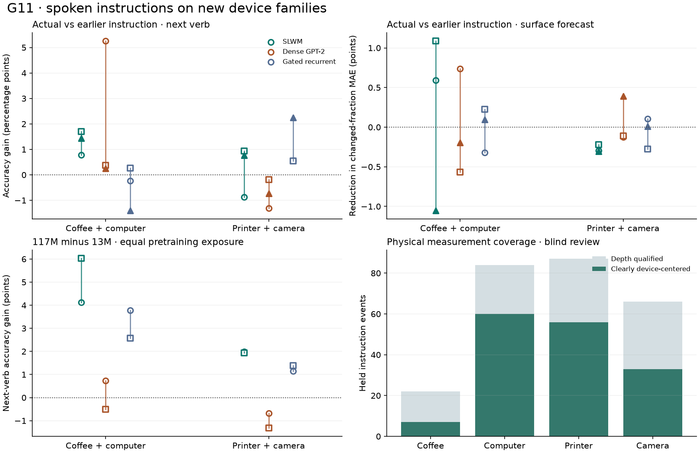

# G11 · do spoken instructions predict manipulation and physical change on new devices?

The correct spoken instruction frequently changed a 13M model’s prediction. Its advantage on held devices was inconsistent. Of 18 architecture–seed–fold cells, **0/18** passed the instruction criterion for next verb and **0/18** for physical error. Geometric registration passed the synthetic checks, while real-device attribution was limited in the independently reviewed frames.

Positive values in the first two panels favor the actual spoken directive over an earlier one from the same recording. The first two panels show three training seeds. The size panel shows two independent G9-lineage seeds. Paired intervals and all controls are available at recording level.

## What information was available?

We used public HoloAssist synchronized video, original pitch-shifted microphone recordings, headset IMU, gaze, hand poses, camera calibration and near-depth frames. A prediction stops after the instructor finishes speaking and at least 200 ms before the first following unambiguous action starts. Each input includes 3.2 s of scene history with conversation-masked acoustics. The current utterance enters at the cutoff through its acoustic encoding and automatically recognized words. The wrong condition replaces both with those of an earlier distinct directive from the same instructor and recording. No future noun or action label is fed into the predictor. [Original recordings](https://holoassist.github.io/) · [Causal split and source hashes](metrics/data.json) · [Held event index](metrics/held-decisions.jsonl.gz)

Fold A withheld coffee machines and computers. Fold B withheld printers and cameras. Each fold used 256 training recordings. The 96 new primary recordings did not occur in G10. Device-family transfer is measured here. The public recording IDs do not establish disjoint individual people or individual serial-numbered machines.

| Fold | Held opportunities | Recordings | Explicit action-word conflicts | Nouns in the training vocabulary | Tiny / stronger ASR word error |
| --- | ---: | ---: | ---: | ---: | ---: |
| A | 403 | 48 | 158 | 102/403 | 67.4% / 49.6% |
| B | 435 | 48 | 129 | 168/435 | 53.8% / 34.1% |

## Next action

All primary heads read the same 128-coordinate field. Each core has the same 13,245,696-parameter parent and 507,204 trainable adapter/edge/head coefficients. The parent count includes its original G10 heads. G11 uses the shared encoder with new action and effect heads. We trained actual-instruction, deranged-instruction and absent-instruction arms with identical histories, labels and draws. Each mean gives both held families equal weight, then equally weights recordings within a family. We bootstrap entire recordings within each held family 4,000 times. Seeds are always reported separately.

| Correctly trained core | Next-verb accuracy, A (%) | Next-verb accuracy, B (%) | Predictions changed by wrong speech, A (%) | Predictions changed by wrong speech, B (%) |
| --- | ---: | ---: | ---: | ---: |
| SLWM | 16.6 / 14.7 / 11.5 | 11.5 / 11.7 / 12.7 | 51.2 / 57.7 / 63.1 | 60.5 / 52.6 / 56.0 |
| Dense GPT-2 | 12.5 / 12.5 / 12.2 | 9.9 / 12.4 / 11.2 | 56.0 / 62.0 / 62.5 | 60.8 / 59.2 / 49.9 |
| Gated recurrent | 12.6 / 14.0 / 11.1 | 9.5 / 12.5 / 14.1 | 66.7 / 62.0 / 59.8 | 60.9 / 62.9 / 60.3 |

The training action-frequency baseline reached 23.4% / 18.1% in A/B. The transition after the previous completed annotated action reached 19.7% / 22.3%. Repeating the previous completed action gave 11.1% / 16.5%. The annotation-history controls are privileged relative to the sensor-only neural prefix. The raw-history readout gave 19.8% / 12.2%. A closed noun head cannot recover a noun absent from its training vocabulary. The semantic readout uses the published noun inventory. In the two held folds, 301/403 and 267/435 target nouns were absent from the respective training vocabularies. [Primary comparisons](primary.md) · [Full signed effects, human and ASR substitutions](metrics/primary.json)

On a fixed set of 512 **training** decisions per fold, mean paired-model verb accuracy was 59.5% versus 23.4% when speech was swapped in A, and 65.1% versus 22.9% in B. That large training advantage collapsed on fresh devices. Selecting an earlier existing checkpoint by development log loss chose step 256 in 18 of 18 paired cells and produced 0 held two-intervention passes. Earlier development-selected weights improved absolute accuracy. The speech-specific benefit still failed the held test. [Selection rule](development-selection.md) · [Frozen readouts and rung measurements](metrics/diagnostics.json)

Reference-transcript action words matched at least one of the next three annotations more often for the true directive than for the same-scene substitute: +6.1 [0.7, 11.5] / +8.1 [3.3, 12.5] points. For just the next verb, the lexical advantage was +3.5 [−0.5, 7.4] / +4.1 [approximately 0, 7.6]. In frozen-field exploratory probes, action-word content was more recoverable from the actual cue than its foil. The check uses a small fixed lexical grouping and does not establish learned plan execution. [Measured speech information](metrics/measurement.json) · [Exploratory probe design](cue-content.md)

## Physical effect

The geometric target is a persistent change over 25 mm in hand-excluded, world-registered near-field surface cells. The independent pre-action locator measures an attended or fingertip-adjacent region. Two before and two after observations bracket the manipulation. The predictor's optional depth input is computed only at the earlier speech cutoff and is stored independently of future quality. A static plane with camera motion produced zero changed cells. Moving exactly half of a synthetic surface by 50 mm produced 50% changed cells and a recovered full-patch mean magnitude of 25.0 mm. [Extraction, calibration and masks](measurement.md)

There were 106 qualified local effects in 39 recordings in A and 153 in 41 recordings in B. The no-change persistence MAEs were 15.8 and 9.0 percentage points of changed area. The training-mean MAEs were 13.0 and 11.3. The primary paired models did not consistently improve when the correct speech replaced the same-scene foil. The stricter isolated, hand-adjacent subset retained 40 / 91 observations. A single analyst reviewed every retained held center without the verb or model scores. **156/259** clearly lay on a device or device component. Only seven coffee centers qualified. Foreground-minus-surrounding differences were −1.8 [−6.5, 3.5] / −0.2 [−1.9, 1.6] points. Attribution of every measured change to the device is unsupported. These tests do not measure hidden power state, contact force or mechanical success. [Blind review sheets](audit/README.md) · [Per-center decisions](metrics/device-audit.json)

## Does more capacity recover an instruction benefit?

The independent size experiment compares 13M and 117M G9-lineage parents. Each parent saw identical data and **16,777,216 pretraining clock positions** at both sizes. Four gated parents were trained to complete the equal-exposure comparison with the eight previously released hybrid/dense parents. Small and large parents saw roughly 1.27 and 0.14 sampled positions per stored parameter. The larger size has more free adapter coefficients at the same low rank. The comparison identifies size effects at one pretraining budget. Convergence at equal information per parameter remains open. The following paired fits use seeds 911 and 912, distinct from the primary factorial.

| Core | Fold | 13M correct verb (%) | 117M correct verb (%) | Change in the correct-minus-wrong benefit (points) |
| --- | --- | ---: | ---: | ---: |
| SLWM | A | 11.1 / 11.9 | 15.2 / 17.9 | 1.6 / 1.4 |
| SLWM | B | 10.9 / 11.2 | 12.9 / 13.2 | -1.0 / 0.6 |
| Dense GPT-2 | A | 12.6 / 13.7 | 13.4 / 13.2 | 2.1 / -0.5 |
| Dense GPT-2 | B | 13.6 / 13.8 | 12.9 / 12.5 | -1.1 / 3.5 |
| Gated recurrent | A | 9.5 / 12.9 | 13.3 / 15.5 | 5.7 / 3.2 |
| Gated recurrent | B | 11.7 / 12.1 | 12.9 / 13.4 | 0.3 / -0.5 |

For the small size, 0 of 12 cells passed the two instruction contrasts for next verb and 0 for changed-area error. The corresponding large counts were 0 and 0. The larger SLWM improved absolute verb accuracy in both seeds in both folds. Only one of those four paired accuracy intervals excluded zero. None of the larger cells passed the speech-specific criterion. Every size difference and intervention is paired at the same held recording. [Scale results](metrics/scale.json) · [Parent exposure and hashes](metrics/scale-parents.json)

## Artifacts, compute and next experiment

We completed **82 fits**: 54 primary adapters, 24 scale adapters and four new gated pretraining parents. The 250 new adapter/optimizer or full-parent generations passed independent readback on both checkpoint HDDs. Public packages contain the three matched small backbones and six seed-1001 adapters. A real microphone clip, its earlier foil, silent input and independent transcript conditions were tested through the released inference command. [Run the models](inference/README.md) · [Listen to a matched pair](examples/README.md) · [Full paired observations](metrics/primary-predictions.npz)

A single predetermined, clearly visible coffee-device example illustrates the recognition problem. The source instruction says “And now the drip tray.” The tiny recognizer returned “And now, literally.” The next annotation was withdraw / drip tray. The portable hybrid selected screw under the actual cue and hold under the earlier cue. This example was selected by source ID hash. [Audible case and measured outcome](examples/outcomes.json)

The cumulative project allowance is now **600 Colab units**. G11 used 0.00 tracked Colab units, bringing cumulative use to 46.16. All owned assignments have been released. Google returned assignment timeouts or Service Unavailable on v6e after the upgrade. No v6e speed ratio was observed. On the RTX 3090 the measured 128-example dense workload processed approximately 706k and 107k history positions/s for the 13M and 117M parents. The timing fixture uses fixed public training examples and initialized parameters. It times complete adapter optimizer updates in four warm blocks of 16. The private Drive transfer worker is retrying under its project quota. It had 0 G11 files verified at release. [Compute and storage ledger](metrics/release.json) · [Reproduction](reproduction.md)

The next useful comparison is to ground a spoken directive in its full manipulation sequence and a device-specific sensor or independently annotated state transition. Preserve same-scene speech substitutes, train-versus-held checks, a no-change forecast and a simple action-transition reference. A useful benchmark should first show that the chosen sensor can distinguish the device event from motion elsewhere in the scene.
