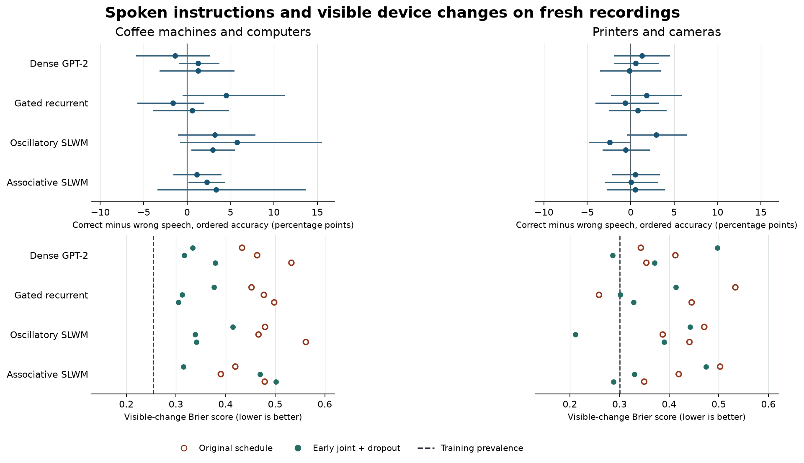

# G12 · Can a small shared world model use speech to forecast three actions and a device change?

The correct instruction did not reliably improve either endpoint over both an earlier instruction from the same scene and silence. **Zero of 24 primary architecture–seed–fold comparisons** passed both speech controls on fresh recordings for ordered action accuracy. The count was also zero for visible-state Brier score. The 16 wider models yielded zero passes on either endpoint. Neither new SLWM processor established superiority over the matched dense GPT-2 processor across the two held-device splits. [Registered protocol](protocol.md) · [Paired estimates and recording intervals](metrics/comparisons.json)

## What was actually held out?

Fold A excluded every coffee-machine and computer task from training. Fold B excluded every printer and camera task. Each used 256 training recordings, 255 of which contributed eligible rows. The 48 fresh recording groups were previously unused by G10/G11 and yielded **158 and 215** complete triplets. A separate replication panel yielded 304 and 380 decisions from the G11 cohorts. The public data support held recording groups and device families. They do not identify distinct machine serial numbers or guarantee unseen people. [Public HoloAssist data](https://holoassist.github.io/) · [Group assignments, source hashes and counts](metrics/data.json)

Each decision ends after the instructor finishes speaking, at least 200 ms before the first action. All three verb onsets fall within 12 seconds of the first. Each model sees the same pre-action RGB, ImageNet visual features, speech-masked ambient sound, headset motion and completed directive. The speech intervention substitutes the audio and recognized words of a different, earlier directive from the same recording and instructor. The scene remains identical. Later instructors can intervene during the three-action horizon, which occurred in 53/158 and 69/215 decisions. The release includes a restricted analysis and all source clocks. This is an observational forecast. [Event list](metrics/decisions.jsonl.gz) · [Training recipe](training.md)

## Action sequences and physical outcomes

The table averages the three fixed training seeds for description. Each seed receives a separate 4,000-draw paired recording bootstrap within each held family. Ordered accuracy is the average of the three position-wise top-1 indicators. Exact accuracy requires all three verbs in order. Brier measures squared probability error for a directly visible change. Lower is better.

| Correct-input model or reference | Ordered accuracy A / B | Exact triplet A / B | Visible-state Brier A / B |
| --- | ---: | ---: | ---: |
| Dense GPT-2-style processor | 11.3% / 10.4% | 0.1% / 0.0% | 0.477 / 0.370 |
| Gated recurrent | 11.4% / 11.3% | 0.1% / 0.0% | 0.476 / 0.413 |
| Oscillatory SLWM | 14.3% / 10.8% | 2.8% / 0.0% | 0.503 / 0.433 |
| Associative SLWM | 12.9% / 10.8% | 1.5% / 0.0% | 0.430 / 0.424 |
| Most frequent training verb per position | 16.8% / 17.3% | 0.0% / 0.0% | — |
| Repeat the previous annotated verb | 8.2% / 10.2% | 0.0% / 0.0% | — |
| Follow training transitions from the last annotated verb | 14.9% / 16.3% | See paired data | — |
| Raw pooled signal readout | 13.0% / 10.5% | See paired data | 0.415 / 0.407 |
| Always predict no device change | — | — | 0.517 / 0.671 |
| Predict training change prevalence | — | — | **0.254 / 0.300** |

The previous-verb controls get a privileged completed-action annotation. The shared processors receive sensor history only. More than 98% of the fresh target verb positions had training vocabulary support in both splits. A vocabulary miss explains little of the accuracy gap. [Full baselines and per-device results](metrics/comparisons.json) · [Recomputable paired predictions](metrics/paired-predictions.npz)

A Codex visual reviewer scored four source frames per case without seeing roles, time orientation, instructions, actions or model outputs. Of 144 sampled fresh outcomes, **77 were readable**, including 49 changes and 28 stable configurations. These were visible events such as a printer bay opening, a camera lens being detached or a display changing. There were 36 readable cases in A and 41 in B. The reviewer agreed on 56/57 masked repeats. The state sample was enriched for likely manipulations. Its prevalence, the single visual reviewer and the few readable outcomes per family limit interpretation. [All blinded frames and individual ratings](audit/README.md)

## What helps, and where?

- **Speech has measurable content.** A human-transcript action word matched one of the three later verbs 9.7 percentage points more often than the foil in A (95% interval 2.9 to 17.2), and 7.2 points more often in B (−2.8 to 15.1). The automatic recognizer’s word error was 54.3% and 37.3%. Human-transcript substitution also failed to produce a consistent gain across the seed-1201 processors. On the fixed training slice, seed-1201 associative accuracy was 51.0% versus 23.1% for swapped speech in A and 50.5% versus 23.5% in B. This large training advantage disappeared on fresh devices. The grounding loss had 327 and 307 eligible cued training examples. Its seed-averaged action gains over ordinary paired training were below one point for every processor in both folds. [Speech inventory](metrics/speech.json) · [Training and word-substitution controls](metrics/comparisons.json)
- **There is a local scaling result for the oscillatory processor.** At equal exposure, widening it from 128 to 256 internal coordinates increased printer/camera ordered accuracy by **5.4 points** (2.5 to 8.1) and **2.8 points** (0.1 to 5.6) in two seeds. Its gains over the equally wide dense GPT-2 control were 3.3 points (0.8 to 5.9) and 0.9 points (−1.1 to 2.8). In coffee/computer, width changes were +3.9 and −4.3 points, with both intervals crossing zero. The 128-coordinate emitted field and the amount of independent data were fixed. This measures width at one data budget. [Width protocol](width.md) · [All 16 wide comparisons](metrics/width.json)
- **The training schedule mattered.** All 48 original runs selected the earlier eligible joint checkpoint at 512 updates. In the development-triggered rerun, 45/48 selected 96 or 192 updates and three selected 384. Compared on the same fresh decisions with their original schedule, 28/48 early fits had positive paired accuracy intervals and 16/48 had lower Brier intervals. These comparisons share recordings and model lineages. The full-input early gated model averaged **17.4% versus 14.0% for dense GPT-2** in printer/camera, with two of three paired gains excluding zero. In coffee/computer it averaged **13.7% versus 15.7%**. Modality dropout did not yield a replicated SLWM advantage. [Locked follow-up](development-followup.md) · [All early fits](metrics/early.json)
- **State probability calibration explains part of the physical error.** An exploratory calibration fit only on development scores and labels reduced several extreme Brier scores. Among the 12 normally paired primary models per fold, zero in A and one in B had a positive paired interval against an intercept-only predictor calibrated on the same development labels. Within-family state AUC ranged from 0.24–0.53 in A and 0.26–0.68 in B. The useful scientific question is whether the field tracks which component changed over successive observations. [Calibration analysis and constant-probability control](metrics/calibration.json)

## Small processor, shared codecs and live operation

The four primary processors have 945,582 or 945,711 trainable parameters, depending on the fold vocabulary. The wide comparison has 3,441,326 or 3,441,455. A dense causal self-attention processor, a gated recurrent processor, a damped oscillatory field and a decaying associative field use the same trainable shapes, sampling, rollouts and uncertainty heads. They share a frozen 11.18M-parameter ResNet-18 visual backbone and a 241.73M-parameter Whisper-small.en recognizer. The small counts describe the trainable world model. Full raw-media deployment also needs the codecs. [Processor implementation](../../../../models/g12_world.py) · [Development selection criteria](training.md)

Four real chronological replays lasted **603 seconds in total** and contained 642 update clocks. At each clock the shared processor proposes three prospective verbs and a change probability. The gate independently chooses action decoding, state decoding, both or internal-only processing. Across the four streams, the primary associative policy issued **16 action proposals**, made 221 state commitments and stayed internal-only on 413 clocks. It proposed actions on zero of the 56 clocks with no current or following action within eight seconds. Dense GPT-2 and the plain gated model also emitted zero action proposals on those clocks. The small number of proposals on all clocks limits the evidence for useful autonomous work. This is prerecorded causal replay with annotated directive boundaries, an eight-second scene window and no physical actuation. [Listen and inspect the continuous runs](examples/README.md) · [Policy counts](metrics/live.json)

**The next experiment should distinguish the requested goal from the preparatory movements.** Use repeated, scene-matched choices where different spoken goals lead to different observable outcomes, with a second independent state rater or direct telemetry. Train the model to predict a component-specific transition and whether it occurred anywhere in the instructed sequence. Keep the frequency and calibrated constant-state references. The width and early-training results justify retaining an oscillatory candidate and a plain gated control in that experiment.

All 112 fits ran on the RTX 3090. Six official Colab v6e allocations returned timeouts or service-unavailable responses. G12 used zero Colab units. Project usage stands at 46.16 of 600 units. Both physical checkpoint disks passed readback of 384 optimizer/model generations. The release contains 24 losslessly packed inference models with identical fresh-case action and state probabilities under true, wrong and absent speech. Eight real-waveform substitutions also completed through the public interface. The private Drive worker had one verified file at release and was backing off under the shared quota. [Run inference](inference/README.md) · [Compute receipt](metrics/compute.json) · [Storage and verification](metrics/release.json)
