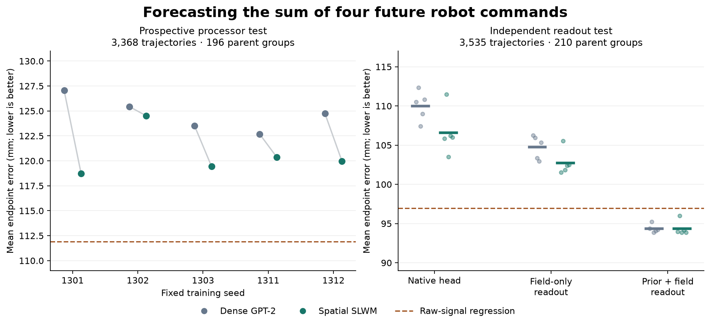
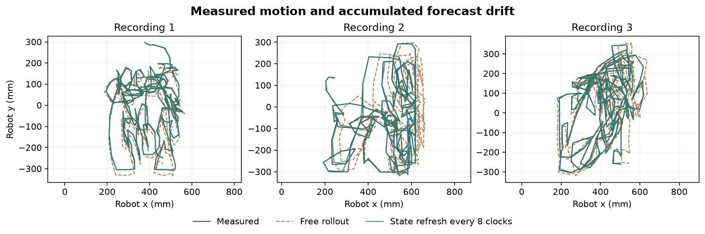

# G13 · What actually improves small world models?

**A spatial SLWM beat matched dense GPT-2 on a prospectively registered action forecast. An improved training target then helped both architectures beat a stronger raw-signal predictor.** These results come from successive acquisitions of real robot trajectories with measured motion. Natural speech transferred better to component identity than to the exact next three verbs. The release includes 182 neural fits, six continuous physical replays and 27 runnable model packages. [Prospective processor result](prospective-findings.md) · [Verified release](metrics/release.json) · [Run inference](inference/README.md)

## From an architecture win to a better predictor

The robot model encodes camera observations, color components, measured pose, earlier controls and a text goal into a shared field with five slots and 128 coordinates per slot. A proposal head anticipates the sum of the next four 2D control commands. A separate head predicts measured motion for a supplied candidate plan. Changing a future plan left passive action and object predictions identical in the released parity checks. The compared trainable cores have **700,301 parameters** and see the same examples. The control annotations are hindsight goals supplied by Language-Table. [Causal controls](metrics/world-parity.json) · [Original data and methods](https://github.com/google-research/language-table)

| Research decision | Evidence on held data | Consequence |
| --- | --- | --- |
| Give named objects their own slots and bind goal roles to them | With dense GPT-2 itself, original-measurement object accuracy increased by 6.0, 7.0 and 5.7 points in the first external cohort. All three paired 95% intervals excluded zero. | Keep this input organization for both dense and signal processors. |
| Test spatially weighted associative memory against ordinary dense attention | On the preregistered third cohort, all five seeds favored SLWM. The mean advantage was **4.07 mm** (99% interval **3.31–4.85**). The two additional training seeds gained 2.29 and 4.76 mm. | There is a repeatable processor advantage for this native action head. The independent raw regression still did better than all five native SLWMs. |
| Fit the readout to the quantity actually evaluated | On a fourth acquisition, the SLWM native head scored 106.62 mm and a task-aligned readout of its field scored 102.75 mm. A separately tuned raw predictor reached **96.97 mm**. | The field carries action information that the original head underused. |
| Retain the two raw action coordinates and learn a correction from 126 field coordinates | The same SLWMs reached **94.37 mm**, a **2.60 mm gain** over the strong raw predictor (99% interval **2.00–3.21**). Dense GPT-2 reached **94.35 mm**. The spatial-minus-dense advantage was −0.019 mm (99% interval −0.260 to +0.218). | Deploy the corrected readout as the reference. Its value transfers across processor families. |

The third cohort contains 3,368 trajectories, 13,678 windows and 196 parent groups. The fourth contains 3,535 trajectories, 15,035 windows and 210 parent groups. Each acquisition excluded every earlier parent and every exact overlapping camera frame. The four-command target, five seeds, source pairing and new shards were locked before the prospective evaluation. The final readout used out-of-recording-fold raw predictions when learning its correction. A post-hoc raw-prior recalibration scored 96.94 mm and an equal-width untrained nonlinear-feature control also scored 96.94 mm. The learned coordinates improved on both. Uncertainty resamples parent groups; the five-seed estimate summarizes the fixed seeds tested. [Third-cohort measurements](metrics/prospective.json) · [Fourth-cohort measurements](metrics/direct-action.json) · [Matched readouts](metrics/process-comparisons.json) · [Attribution controls](metrics/readout-controls.json)

## Separate intended action from physical effect

With four proposed future controls supplied, the training-only linear response model predicted the realized effector displacement to **4.63 mm** on the initial held cohort and **6.18 mm** on the first independent acquisition. Simply integrating the same controls gave 36.87 and 39.60 mm. Assuming no motion gave 93.46 and 99.15 mm. Modeling nonlinear response reduced the two errors to 4.59 and 6.17 mm. This small additional change is consistent with a predominantly linear short-horizon actuator response. Without a candidate control, the passive linear forecast erred by 78.44 and 83.91 mm. Forecasting what a given command does is a substantially easier problem than anticipating the operator's command.

In an offline decision test, each set contained four recorded options from different, nearby starting states. Parent groups were disjoint between option sets. Four fixed desired displacement vectors were issued per set. On the independent cohort, the fitted linear response selected the best recorded option **92.2%** of the time with 0.33 mm mean regret across 51 sets. Direct integration reached 85.8% and 1.14 mm. This exercise ranks recorded options. It does not establish the success of executing an unobserved alternative from an identical physical state. [All physical and decision controls](metrics/robot-results.json)

The three longest unambiguous camera/state chains in the third cohort contained 306, 286 and 271 observations. Joining subtrajectories required two matching consecutive frame/pose identities and an unambiguous continuation. The released spatial field ran 299, 279 and 264 individual forecast clocks. Its four-step error with current telemetry was 3.33, 6.09 and 6.71 mm. With only the initial sensory prefix and subsequent recorded commands, mean position error rose to 15.5, 31.2 and 21.9 mm. Refreshing measured state every eight clocks reduced it to 3.8, 7.1 and 8.3 mm. Both models get the same history and controls. At no point did a generated proposal actuate the robot. [Recorded replay and lineage](examples/README.md) · [Clock, gating and drift measurements](metrics/live.json)

## Audit the target before scaling the core

The original centroid matcher often labeled blue motion when the arm occluded a block or the colored support changed. A single Codex reviewer inspected blinded, randomly oriented before/after frames. On development, switching to bidirectional changes in saturated color support increased correct determinate assignments from 30 to 42 and reduced wrong assignments from twelve to five. That comparison selected the measurement method.

The independent uniform audit used 100 new cases. The reviewer could classify 83. The original detector agreed on 25 of the 31 cases readable by both. The corrected detector agreed on **56 of 63**, with **75 of 100** receiving an automated label versus 37 previously. On the separately chosen blue challenge, the counts were 1/8 and 19/21. The source-balanced gain in the prespecified signed utility on the uniform sample was 0.35 (95% interval 0.16–0.54). This measures visible block motion, with explicit unknowns. One reviewer's consistency cannot establish inter-rater agreement. [Blind ratings and source reconstruction](audit/README.md) · [Full measurement audit](metrics/measurement.json)

On the first independent cohort, the corrected measurement yielded 2,763 valid object outcomes, including 408 on color-pair compositions withheld from training. With genuine hindsight text the seed-1301 spatial anchored field gained **59.5 percentage points** in moved-object accuracy over a different goal from the same parent (95% interval 56.3–62.7) and **38.3 points** over no goal (34.5–42.0). This is predictive association with a human retrospective description; the text was not a randomized command issued to the demonstrator. Its full-cohort accuracy was approximately 69%. The training-derived role prior reached 67.8% and a raw pooled readout reached 70.0%. Much of the apparent grounding is available to these simple references. [Matched interventions, unseen compositions and human-rated subsets](metrics/robot-results.json)

## What does real speech contribute?

**Natural verb anticipation.** On 48 new HoloAssist recordings, the original transferred heads averaged 17.85% / 14.06% ordered three-verb accuracy in the two device splits. Adding independent transcripts, shrinkage and a lexical correction yielded 17.85% / 14.36%. Training-frequency controls scored 19.43% / 14.31%. The final disjoint expansion added 4,523 examples from 670 recordings in A and 2,624 from 465 recordings in B. This route did not repair the immediate action sequence. [Disjoint natural verb results](metrics/holo-clean.json)

**Natural component anticipation.** A new field predicted one of **165 public component names**. A hit means the proposed noun occurs in the next three actions. Across 567 decisions in 64 held audiovisual recordings, preserving a semantic residual from the completed directive raised mean top-one accuracy from **3.79% to 25.95%** in coffee/Switch and from **1.20% to 22.85%** in printer/camera. Top-five accuracy reached 44.1% / 43.9%. On cases where *all* future targets were absent from training, semantic fields averaged 22.7% / 21.5%; the freely learned fields reached zero in these cases. True/earlier/silent scores for semantic fields were 26.0/12.6/2.7% in A and 22.9/18.0/3.1% in B. The true-cue advantage met the two-control rule throughout A and did not replicate across seeds in B. Frozen MiniLM retrieval alone reached 25.9% / 24.5%. The positive result is retention of transferable lexical knowledge in the shared field; these numbers do not establish an additional advantage over the pretrained lexical edge. The causal context includes native speech, automatically recognized words, video, non-speech sound and IMU. [All architecture and lexical controls](metrics/component-results.json) · [Paired representation changes](metrics/process-comparisons.json)

All 64 component recordings were new audiovisual acquisitions but their transcripts had been available to the separate exploratory verb pilot. We identified that overlap before fitting the component models, removed all 64 from the released verb expansion, and reran its development selection and test. Component model training and selection were always disjoint from the target recordings and device families. This cohort supports held-model transfer, not a claim of completely project-naive transcript content. [Lineage correction](component-lineage.md)

**Controlled spoken goals.** Actual Speech Commands microphone clips supplied a direction word for compatible robot annotations. The earlier text channel had its direction words removed, and the wrong waveform came from the same held speaker saying the opposite word. This cross-corpus intervention is separate from naturally aligned instructions. On the independent robot acquisition the canonical seed-1301 spatial field with four protected speech coordinates predicted the *measured effector* direction at **51.2%** with the correct word, 45.0% with the opposite word and 49.8% with silence. The paired advantage over the opposite word was 6.2 points (3.1–9.2); the 1.4-point advantage over silence included zero. The corresponding object-direction scores were 40.6%, 40.7% and 43.8%. Strong isolated recognition therefore was insufficient for reliable object-direction transfer. [Corrected voice-transfer cases and source intervals](metrics/voice-portable-transfer.json) · [Listen and run substitutions](examples/README.md)

The original direction classifier had an actionable backend fault. The held speaker-balanced accuracy was 95.6% with the batched CUDA scorer and 50.9% on CPU. Replacing the convolution with explicit padded patches and retraining gave **95.0% on both backends**, 96.5% per clip, identical top predictions on all 1,639 clips from 229 held speakers, and a maximum probability difference of 0.00053. All downstream spoken-goal probes were refit. [Portability investigation](speech-portability.md) · [CPU/CUDA evidence](metrics/speech-parity.json) · [32 true/foil waveform checks](metrics/voice-waveforms.json)

## Research decision

Keep the physical response reference, the target-aligned action readout and the semantic residual. Keep the spatial SLWM and dense GPT-2 as matched candidates. The best deployment scores currently give little reason to enlarge the backbone. The next discriminating experiment is an environment with the *same measured initial state*, randomized spoken goals, executed candidate actions and independently recorded task success. Measure whether the additional 126 learned coordinates improve achieved outcomes over the raw controller and whether current sensory updates prevent drift over much longer tasks.

The study used 28 whole Language-Table shards (23.79 GB), retained 23,533 robot subtrajectories and trained on 8,962 of them in 583 original source groups. It used separate actual-speech and HoloAssist banks. The 3090 completed all fits; the two named v6e allocation attempts timed out or returned service unavailable. G13 consumed zero Colab credits. Both checkpoint HDDs passed independent readback of all 594 generations. Drive was still backing off under its shared project quota at release. [Data and source hashes](metrics/data.json) · [Budget](metrics/compute.json) · [Checkpoint verification](metrics/release.json) · [Reproduction](reproduction.md)
