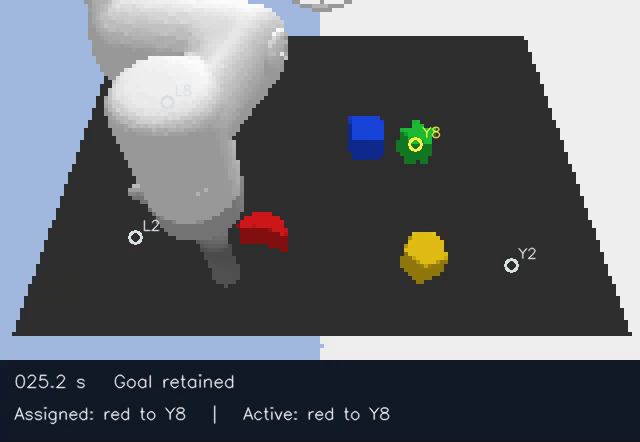

# Watch the continuous spoken missions

Each video contains six original human instructions and 61.2 seconds of uninterrupted simulated tabletop control. The camera updates throughout the mission, including while the speaker’s next recording plays. The controller receives the cached speech decoding only after the complete recording. Both videos use the spatial seed-1411 policy. Their mission indices were fixed in advance.

| Recording | Video with original speech | Native motion and selected actions |
|---|---|---|
| First original-cohort mission | [Watch 61.2 seconds](mission-00.mp4) | [Trajectory arrays](mission-00.npz) |
| First fresh-speaker mission | [Watch 61.2 seconds](mission-08.mp4) | [Trajectory arrays](mission-08.npz) |

Across 16 missions and 96 instructed placements, spatial SLWM and dense GPT-2 each made 54 selective placements. Geometric feedback made 47. The paired spatial gain over geometry was 7.3 percentage points with a 95% interval of 1.0 to 13.5. The spatial-minus-dense interval was −7.3 to +7.3 points. Clearing the active goal after one action produced zero selective placements. Keeping only the first accepted goal produced 25. The retained goal is explicit controller memory. [Every phase and outcome](mission-outcomes.json) · [Complete mission statistics](../metrics/missions.json) · [Protocol](../missions.md)

Martin Cooke, Jon Barker, Stuart Cunningham and Xu Shao released *The Grid Audio-Visual Speech Corpus* under CC BY 4.0. Its audio was aligned to the recording clock and placed at each cue onset. The videos show the camera in Google's open Language-Table simulator. [Original recordings](https://doi.org/10.5281/zenodo.3625687) · [Speech license](https://creativecommons.org/licenses/by/4.0/) · [Simulator](https://github.com/google-research/language-table)
