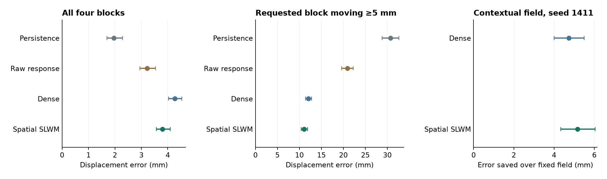

# Predicting movement after contact on unseen tabletop starts

The frozen fields predicted the 300 ms outcome of eight candidate pushes at each of 1,024 previously unseen contexts. The 64 independently seeded worlds contributed 8,192 isolated outcomes. All predictors received the same instructed object, destination, camera history and actuator observations. The intervention panel was registered before its new outcomes were generated. [Protocol](held-prediction.md) · [Inputs](metrics/held-physics-inputs.npz) · [All predictions and measurements](metrics/held-physics-predictions.npz)

| Predictor | Error across all four blocks | Requested block, all candidates | Requested block when moving ≥5 mm | Lost 1.5-second return |
|---|---:|---:|---:|---:|
| Persistence and nominal action | 1.97 mm | 5.88 mm | 30.74 mm | 15.22 mm-equivalent |
| Raw linear response | 3.22 mm | 4.90 mm | 20.96 mm | 13.47 mm-equivalent |
| Dense GPT-2 style | 4.26 mm | 4.43 mm | 12.04 mm | 13.13 mm-equivalent |
| Spatial SLWM | 3.80 mm | 4.32 mm | 11.07 mm | 12.73 mm-equivalent |

The requested block moved at least 5 mm in 1,516 candidate executions across all 64 worlds. Spatial SLWM had lower moving-target error at each matched seed. Its three-seed mean gained **0.96 mm** over dense, with a paired 95% interval of **0.68–1.25 mm**. At seed 1411, holding the 126 learned coordinates at their training mean increased moving-target error by **5.17 mm** for spatial and **4.74 mm** for dense. The raw proposal, candidate features, physical prior and downstream weights stayed available. Both processors carry useful contextual physical information. The spatial processor's delayed action-ranking gain over dense was 0.40 mm-equivalent, with an interval from −0.31 to +1.13. [World-level uncertainty](metrics/held-prediction.json)

Persistence achieved the lowest average error across all four blocks. In a follow-up diagnosis, 23,735 of 24,576 non-requested block observations moved at most 1 mm. Spatial forecasts predicted at least 5 mm of movement for 19.5% of those quiet distractors, dense for 25.2%, and the raw predictor for 9.9%. A per-object probability of motion and an explicit no-motion prediction are concrete candidates for the next iteration. [Quiet-object diagnosis](metrics/quiet-objects.json)

A separate matched deployment check held the contact gate and speech route fixed. Across 64 prespecified original-cohort worlds, switching from the original one-step fit to the selected continuation fit changed selective placement by 0.0 percentage points for both seed-1411 processors. Across 32 fresh-cohort worlds it changed selective placement by −0.8 points for each, with intervals spanning zero. The development gain includes the effect of restricting where the learner may change the geometric action. [Matched training-transfer check](metrics/training-transfer.json) · [Prospective subset rule](training-transfer-check.md)
