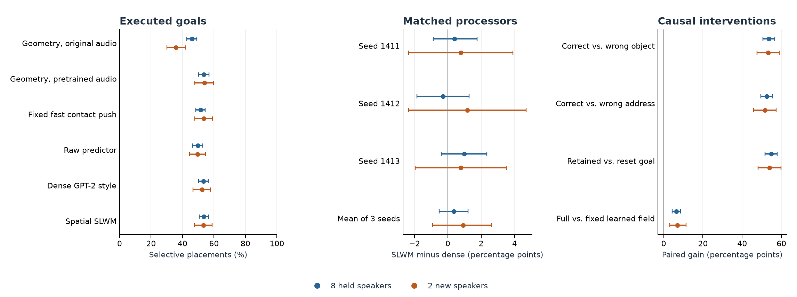
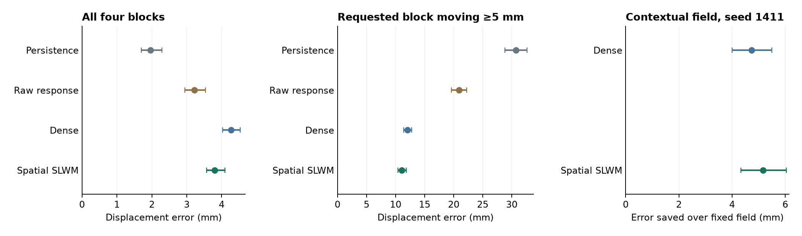

# G14 · Spoken goals, measured counterfactuals and sustained control

Four recordings from the same speaker instructed four different goals from each of **320 independently seeded tabletop starts**. Every registered policy acted from a private copy of the same simulator process. Each episode executed 72 native control ticks. The primary panel covers 54.4 simulated hours and took 71.9 wall-clock minutes after publication of the frozen policy panel. Across the two cohorts, the paired spatial-minus-dense selective placement difference was **+0.4 [-0.5, +1.2]** and **+0.9 [-0.9, +2.6] percentage points**. The matched processor comparison did not meet its registered superiority criterion. [Frozen panel](final-control-lock.json) · [All paired results](metrics/physical-results.json)

The spatial field reduced moving-target forecast error by **0.96 mm** relative to dense on an independent set of 64 worlds. It also carried information used by the physical policy. On the two fresh speakers, replacing the 126 learned coordinates with their training mean lowered seed-1411 placement success by **7.0 percentage points**. Both trained processors benefited from contextual state. Simple geometric feedback reached 53.9% fresh-speaker success. [Independent physical forecasts](physical-forecasts.md) · [Field intervention](field-intervention.md)

## What actually reached the goal?

Selective placement requires the requested block to stay within 25 mm of its requested station for three consecutive observations, with all three other blocks remaining within 35 mm of their starts through that arrival. Terminal distance uses the full 7.2-second episode. Intervals resample complete paired worlds 4,000 times within speaker and contact condition. The published two-speaker intervals condition on those people. The matched neural rows average three fixed training seeds.

| Policy | 256 worlds, 8 speakers | 64 worlds, 2 fresh speakers | Terminal mm, 8 speakers | Terminal mm, 2 speakers |
|---|---:|---:|---:|---:|
| Explicit missing goal | 0.0% [0.0, 0.0] | 0.0% [0.0, 0.0] | 210.6 | 213.0 |
| Direct push | 0.6% [0.2, 1.1] | 0.4% [0.0, 1.2] | 207.9 | 211.1 |
| Geometric feedback | 53.4% [50.2, 56.7] | 53.9% [47.7, 59.8] | 44.9 | 50.2 |
| Fast push at contact | 51.6% [48.4, 54.5] | 53.5% [47.7, 59.0] | 47.5 | 52.5 |
| Raw physical predictor | 49.7% [46.5, 52.8] | 49.6% [44.5, 54.7] | 51.5 | 55.7 |
| Dense GPT-2 style | 53.3% [50.2, 56.3] | 52.3% [46.7, 57.7] | 44.9 | 50.8 |
| Spatial SLWM | 53.6% [50.6, 56.6] | 53.3% [47.5, 58.9] | 44.2 | 48.4 |
| Gated core, original recipe and one seed | 20.4% [18.1, 22.7] | 19.5% [14.8, 24.2] | 123.2 | 132.9 |
| Dense spatial attention, original recipe and one seed | 27.4% [24.8, 30.2] | 30.1% [24.6, 35.2] | 106.7 | 122.0 |
| Geometry with the transcript | 62.8% [59.5, 66.1] | 64.8% [58.2, 71.1] | 18.6 | 20.6 |
| Geometry with transcript and simulator poses | 70.2% [67.2, 73.1] | 74.6% [69.1, 79.7] | 11.8 | 12.3 |

The selected recipe trains on the learner-visited continuation data. Both deployed policies restrict learned corrections to contact. The parameter-matched neural processors each have 160,171 trainable parameters, two blocks, width 80, a 128-coordinate emitted field and eight common candidate actions. Both share an 88.15M-parameter frozen audio encoder and a 182,535-parameter speech head. A calibrated score margin and an explicit contact gate select the action. An auxiliary uncertainty head predicts large one-step utility errors and is available for inspection. Dense uses causal multihead softmax attention. The spatial processor uses position-weighted, decaying positive attention. These runs address the small physical processor. [Training curves and data hashes](metrics/physical-training.json) · [Speech and transfer](speech-and-transfer.md)

The spatial model's learned candidate head ran on 25.7% of the eight-speaker clocks and 25.2% of the fresh-speaker clocks, averaged across seeds. The other clocks followed the explicit approach, goal or absence rule.

| Held cohort and physical condition | Spatial SLWM | Dense | Geometric feedback |
|---|---:|---:|---:|
| 8 speakers, nominal | 53.7% | 52.8% | 52.9% |
| 8 speakers, mass, friction and shape reassigned | 53.5% | 53.7% | 53.9% |
| 2 speakers, nominal | 44.5% | 44.8% | 44.5% |
| 2 speakers, mass, friction and shape reassigned | 62.0% | 59.9% | 63.3% |

## Which inputs and computations changed physical success?

Positive values indicate higher selective-placement success for the first condition. Each cell is a paired percentage-point difference and a 95% interval.

| Intervention | 8 held speakers | 2 fresh speakers |
|---|---:|---:|
| Spatial minus dense, three seeds | +0.4 [-0.5, +1.2] | +0.9 [-0.9, +2.6] |
| Spatial minus geometric feedback | +0.2 [-1.1, +1.5] | -0.7 [-2.9, +1.4] |
| Spatial minus raw learned prior | +3.9 [+2.2, +5.6] | +3.6 [+0.1, +7.3] |
| Spatial minus simple fast contact | +2.1 [+0.1, +4.0] | -0.3 [-3.6, +3.1] |
| Correct spoken object minus substituted object | +53.6 [+50.6, +56.6] | +53.3 [+47.5, +58.9] |
| Correct spoken address minus substituted address | +52.5 [+49.5, +55.5] | +51.6 [+45.8, +57.3] |
| Original learned field minus training mean, spatial seed 1411 | +6.4 [+4.3, +8.6] | +7.0 [+3.1, +11.3] |
| Original learned field minus training mean, dense seed 1411 | +4.1 [+2.3, +5.9] | +4.3 [+1.2, +7.4] |
| Retained goal minus reset after one action, spatial seed 1411 | +54.8 [+51.6, +57.9] | +53.9 [+48.0, +59.8] |
| Pretrained speech minus original acoustic features with geometry | +7.4 [+5.5, +9.3] | +18.0 [+12.1, +23.4] |
| Confidence threshold minus open confidence gate with geometry | -9.4 [-10.9, -7.9] | -10.9 [-14.8, -7.4] |

The spatial advantage had a positive paired lower bound for 0/3 seeds on the eight-speaker cohort and 0/3 seeds on the two new speakers. The protocol requires at least two in each cohort. The field intervention preserves the raw proposal and direct candidate features while replacing the 126 learned coordinates. The six exported models give identical fields for spoken and written versions of the same decoded goal on the published prefix. The explicit goal interface enforces that equivalence. The intervention above tests whether the contextual field adds physical value beyond that interface. [Field intervention](field-intervention.md) · [Portable cross-modal checks](metrics/field-replay.json)

The 1,280 scheduled commands use 391 distinct original recordings. All exact evaluated sentences and speakers are absent from the local fit. A secondary analysis that reweights both individual recordings and their physical starts gives spatial-minus-dense selective differences of +0.4 [-1.0, +1.8] and +0.9 [-1.9, +3.9] points. The contact-randomized family was represented in the continuation data. The held shifts draw new instances within that family. [Source coverage and secondary interval](source-coverage.md) · [Crossed-factor results](metrics/source-sensitivity.json)

## Can the field forecast contact on new worlds?

An independent forward-prediction panel executed 8,192 alternative pushes across 1,024 contexts on 64 new worlds. In 1,516 alternatives the requested block moved at least 5 mm in 300 ms. The predictors received the intended object and station explicitly. The table reports error on measured motion and the return lost by choosing a candidate instead of the best of eight under the fixed 1.5-second continuation.

| Predictor | All four blocks, mm | Requested block, mm | Requested block when moving, mm | Delayed regret, mm-equivalent |
|---|---:|---:|---:|---:|
| Persistence and nominal control | 1.97 | 5.88 | 30.74 | 15.22 |
| Raw linear response | 3.22 | 4.90 | 20.96 | 13.47 |
| Dense, mean of seeds | 4.26 | 4.43 | 12.04 | 13.13 |
| Spatial, mean of seeds | 3.80 | 4.32 | 11.07 | 12.73 |

The paired dense-minus-spatial error on moving targets was +0.96 mm (95% interval +0.68 to +1.25). These are component forecasts from the frozen heads. The primary placement comparisons measure the committed system. [Independent fork protocol](held-prediction.md) · [All effects and paired intervals](metrics/held-prediction.json) · [Measured and predicted displacements](metrics/held-physics-predictions.npz)

Persistence achieved the lowest all-block error. Of 24,576 distractor observations, 23,735 moved at most 1 mm. In the post-hoc diagnostic spatial forecasts predicted ≥5 mm of movement for 19.5% of those quiet blocks, compared with 25.2% for dense. [Physical forecast findings](physical-forecasts.md) · [Quiet-object diagnosis](metrics/quiet-objects.json)

## How the model was trained and selected

Original training used 4,698 states from 320 worlds, with eight physically measured candidate effects per state. Each continuation arm added 2,048 states from the same 128 additional worlds, goals and clocks. Eight candidate controls per state were executed for 15 native ticks, including the common continuation. All 12 definitive continuation fits used 1,024 updates of 128 samples. The 6,746 available states correspond to 19.4 sampled observations per unique state per fit when averaged over the pool. Training was balanced by world. The delayed readout adds 80 parameters to the original processor. The value-development bank contained 512 states on 32 other worlds. Physical policy selection used another 32 starts. The earlier exploratory continuations remain archived. [Exact return data](isolated-training-lock.json) · [Training design](continuation.md)

The snapshot-and-restore diagnostic recovered identical reported poses and joints but could produce up to 72.24 mm difference during a repeated trajectory. Giving each physical branch its own copy of the unadvanced solver reproduced all poses and camera images in eight full-duration checks. All 960 isolated candidate comparisons also reproduced exactly when the enumeration order was reversed. Later independent replay reproduced every native position digest and every selective-placement score across 48 held episodes. The common original one-step labels had a 0.048 mm mean difference under the audit and an individual maximum of 12.09 mm. The longer labels were recollected after failing the registered tolerance. [Solver and training audit](solver-isolation.md) · [Held trace audit](metrics/trajectory-replay.json)

The original routing choice was checked again under isolation. The paired difference for direct minus obstacle-aware routing was +1.3 [-4.5, +7.0] percentage points across the registered three development policies. The common route was locked before this replication.

Across the six development processors the geometry-visited and learner-visited continuation recipes improved one-step selective success by +13.8 [+6.6, +21.1] and +14.6 [+8.3, +21.1] points. The paired learner-versus-teacher change was +0.9 [-2.9, +4.3] points. These intervals describe development, where the recipe was selected.

An additional 768 executions compared the chosen and original training recipes at seed 1411, with both using the same contact gate, utterance and scene. The prespecified subset contains 64 of the eight-speaker worlds and 32 of the two-speaker worlds.

| Chosen minus original training, selective success | 64 original-cohort worlds | 32 fresh-cohort worlds |
|---|---:|---:|
| Dense GPT-2 style | +0.0 [-3.1, +3.1] | -0.8 [-3.9, +2.3] |
| Spatial SLWM | +0.0 [-2.7, +2.7] | -0.8 [-4.7, +3.1] |

[Held transfer controls and raw scene data](metrics/training-transfer.json) · [Prospective subset rule](training-transfer-check.md)

## Ongoing operations and real records

Six original human instructions arrived during each of 16 continuous missions lasting 61.2 seconds each. The controller continued executing its previous goal while the next recording played. Recorded speech posteriors were cached and released only after the complete waveform had elapsed on the simulation clock. An independent CPU/CUDA waveform replay checks the speech edge. The same table, contacts and actuator history persisted throughout each mission. Only the explicit memory controls reset or ignore the goal. Goal retention here is implemented by the controller. The learned core receives four recent frames. [Mission protocol](missions.md) · [Measured mission outcomes](metrics/missions.json) · [Watch and replay](examples/README.md)

| Mission policy | Selective placement | Arrival | Final target error |
|---|---:|---:|---:|
| Geometry, retained goal | 49.0% [41.7, 57.3] | 72.9% | 49.5 mm |
| Dense, retained goal | 56.2% [50.0, 62.5] | 77.1% | 40.5 mm |
| Spatial, retained goal | 56.2% [49.0, 63.5] | 79.2% | 38.3 mm |
| Spatial, reset after one action | 0.0% [0.0, 0.0] | 0.0% | 206.4 mm |
| Spatial, keep first accepted goal | 26.0% [21.9, 30.2] | 28.1% | 161.4 mm |
| Spatial, clear on rejection | 56.2% [49.0, 63.5] | 79.2% | 38.5 mm |

On already satisfied goals the spatial controller emitted zero movement on 98.7% of the tested decision clocks. The explicit absence control did so on 100.0%. Across 768 acoustic input/map challenges the fixed speech gate made zero unsupported commits, including actual recordings naming an unsupported white block. It also rejected 41 valid, correctly decoded commands on the two new speakers. [Acoustic abstention and distinct waveform counts](abstention.md)

Two previously released cohorts of real robot recordings separately measured a four-step, 0.8-second actuator forecast. Four real training recording groups reduced simulation-initialized error from 34.09 to 5.55 mm and from 30.18 to 5.14 mm. Real-only fitting with the same four parents reached the same rounded errors. The counterfactual placement scores above come from the official simulator. The prerecorded real cohorts measure effector response under observed controls. [Real calibration curves](speech-and-transfer.md) · [Original Language-Table simulator](https://github.com/google-research/language-table)

## Compute, scope and next experiment

The RTX 3090 completed 75 neural fits with 225 optimizer/weight generations verified on two independent disks. Two v6e allocation attempts yielded a timeout and service unavailability. This study used 0.00 Colab units. Cumulative tracked use is 46.16 of the authorized 600. At batch one, warm accelerator processing and eight outcome heads took 0.14 ms for dense and 0.14 ms for spatial. At batch 512 they processed 863,836 and 859,169 encoded scenes per second. Camera rendering, speech encoding and simulation are outside these timings. [Throughput](metrics/throughput.json) · [Checkpoint custody](metrics/custody.json) · [Compute accounting](metrics/compute.json)

The physical processor receives camera-based geometry, robot telemetry, action history and an explicitly decoded color–address goal. Success here concerns four tabletop objects, a constrained speech grammar and a supplied station map. The station map assigns the independently recorded GRID commands their meanings in this tabletop task. The two newly acquired speakers were excluded from all SLWM fitting. Their recordings’ membership in Whisper pretraining is unknown. Transfer to new hardware, unconstrained language, new tasks and a learned representation that can generate interchangeable modalities all require separate evidence.

Train a per-object motion probability with an explicit stationary outcome and a conditional displacement head. Use predicted collateral motion to rank pushes, then test against the current geometry, dense and fixed-field controls on new object shapes and materials. Calibrate the actuator on separate real recordings before a physical placement trial.

[Runnable models](inference/README.md) · [Underlying per-scene results for eight speakers](metrics/held-scene-results.npz) · [Per-scene results for two new speakers](metrics/fresh-scene-results.npz) · [Release receipt](metrics/release.json)
