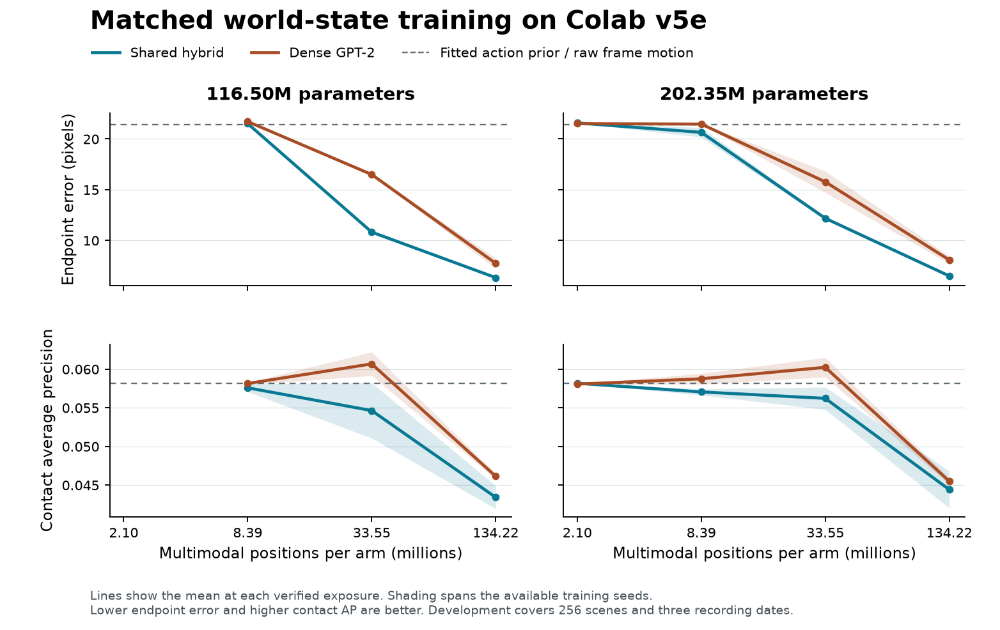

# G6 multimodal scaling results

**The hybrid learned useful visual action dynamics and transferred some speech-command content across input modalities. Increasing its backbone from 116.50M to 202.35M parameters did not improve its terminal action error. Real event timing overfit sharply, and generated speech remained unintelligible on the fixed recognizer.**

Two native Google Colab v5e-1 sessions trained eight matched models. Each seed compared the hybrid and an all-dense GPT-2-style Transformer on the same chip, with the same data order, physical priors, decoder, learning rate, 128-dimensional shared state and effective batch of 256. Each model completed 8,192 updates, 2,097,152 example exposures and 134,217,728 multimodal clock positions. The study used real text, audio, images and video, robot sensors and actions, alongside controlled simulator interventions. The training pool contained 337,403 rows or histories. [Registered design](protocol.md) · [Exact data exposure](../../t5/interventional-world-20261110/metrics/data-exposure.json)

## Forecasting and scale

| Parameters | Seed | Hybrid action error, px ↓ | Dense action error, px ↓ | Hybrid contact AP ↑ | Dense contact AP ↑ |
| ---: | ---: | ---: | ---: | ---: | ---: |
| 116.50M | 511 | 6.35 | 7.21 | 0.0419 | 0.0465 |
| 116.50M | 512 | 6.30 | 8.26 | 0.0449 | 0.0458 |
| 202.35M | 511 | 6.52 | 8.45 | 0.0420 | 0.0459 |
| 202.35M | 512 | 6.47 | 7.70 | 0.0468 | 0.0451 |

These development measurements use 256 simulator scenes and 668 real impact windows from three recording dates. The fitted action prior scored 21.42 pixels and raw visual motion scored 0.0581 AP. All four matched architecture pairs favored the hybrid on action error. All eight terminal contact scores fell below raw motion. Neither size passed the joint architecture gate. The separately sealed 3090 confirmation gave the same split on 512 other scenes and 1,169 impact windows. [All paired intervals, raw baselines and size controls](matched.md) · [Sealed 3090 results](../../t5/interventional-world-20261110/terminal.md)

The contact failure is consistent with overfitting to the training recordings. For the 202.35M hybrid, training-date AP rose from 0.161 to 0.810 at seed 511 and from 0.151 to 0.802 at seed 512 between 2,048 and 8,192 updates. Over the same interval, held-date AP fell from 0.0548 to 0.0420 and from 0.0577 to 0.0468. Held class-weighted loss also worsened. This post hoc diagnosis evaluated frozen checkpoints with unchanged weights, priors and data selection. [Audit design](contact-generalization.md) · [Seed 511 readouts](supplemental/terminal-v5e-larger-511.json) · [Seed 512 readouts](supplemental/terminal-v5e-larger-512.json)

## Does the camera change a useful decision?

On 512 newly generated counterfactual scenes, the terminal 202.35M hybrid received the same proposed actions with correct, erased or wrong-scene camera history. No numerical state was supplied in those three conditions.

| Seed | Correct video error, px | Erased video error, px | Wrong-scene video error, px | Correct video choice regret, px | Erased video choice regret, px |
| ---: | ---: | ---: | ---: | ---: | ---: |
| 511 | 14.05 | 24.92 | 26.47 | 1.75 | 5.25 |
| 512 | 14.48 | 25.35 | 26.74 | 1.55 | 3.66 |

Both seeds passed the preregistered visual-contribution gate for prediction and action choice. When numerical state was also available, fresh-scene joint error was 6.12 / 6.01 pixels for the 202.35M hybrid versus 8.14 / 7.41 for dense. The 116.50M hybrid achieved 5.89 / 5.84. The visual probe uses a finite library of three executed counterfactual plans and an independently sampled desired displacement. [Fresh-scene specification](scene-controls.md) · [Scene manifest](fresh-scenes-card.json) · [Matched fresh-scene results](fresh-visual-comparison.json)

In the separate 24-decision, 38.4-second closed-loop task, the 116.50M carried-state hybrid beat the fitted prior and dense controller by the registered margin at both seeds. The 202.35M carried model did so at one of two seeds. Its final distances were 85.97 / 117.59 pixels versus 167.20 / 121.70 for dense; the passive agent finished at 88.60. Restarting the larger hybrid's state at each decision yielded 65.54 / 71.30. Useful short forecasts have not yet produced reliably advantageous long-lived memory across these policies. [Fresh goal-reaching protocol](decisions.md) · [Sustained results](transfer-and-decisions.md)

## Shared content, text and continuous generation

A fixed readout trained on eight utterances per command from one modality was applied unaltered to each other modality. On four development speakers the 202.35M hybrid averaged 32.18% / 26.48% across six directional swaps, versus 24.15% / 23.03% for dense. It passed the relative gate again on **749 utterances from eight different speakers with unseen sentence combinations**: 31.04% / 25.81% versus 23.98% / 22.81%. Chance is 25%. The 116.50M model missed this two-seed transfer gate. Directions varied sharply. The larger model's second-seed absolute advantage over chance was small, and the 32-shot results were weaker than the first seed's eight-shot result. The eight-checkpoint lock, fixed training support and speaker exclusions were retained throughout. [Speaker confirmation design](speaker-confirmation.md) · [Weight lock](speaker-confirmation-lock.json) · [All directions, shuffles and speaker-paired intervals](transfer-and-decisions.md)

The 202.35M hybrid scored 2.011 / 2.012 bits per held text byte, versus 2.202 / 2.160 for dense and 3.708 for the empirical training-only bigram. Yet every terminal video-to-speech and transcript-to-speech condition scored 100% word error on the 32-clip development speech diagnostic. Original waveforms scored 51.56% and codec reconstruction 65.63% with the same frozen recognizer. [Text and context controls](text.md) · [Speech and language measurements](transfer-and-decisions.md)

Both terminal 202.35M models generated 43.69 seconds of audio from video, video from audio, and both streams from a sequence of written prompts. The grayscale frames are 16×16 and the generated waveform uses the fixed Vocos decoder. On the one paired recording, the hybrid's generated frame-motion correlation was 0.1263 against a shifted 95th percentile of 0.1094. Its generated sound-energy correlation was 0.0792 versus 0.0905 for the shift control. Dense scored 0.0227 on motion and −0.0304 on sound; both were below their shift controls. The clips demonstrate continuous conditional execution and weak reconstruction of the recording. [Hybrid media hashes](media-hybrid-511.json) · [Dense media hashes](media-dense-511.json)

## Artifacts, credits and next experiment

All 28 registered milestones include exact optimizer state and inference weights. A separate full read-back checked 196 files and 74,182,710,723 bytes on each of two independent Fedora HDDs. The Mac stored small reports and review clips. Both v5e assignments were released after the data were durable. The measured warm training speed at 202.35M was 2.49× the RTX 3090 for the hybrid and 2.31× for dense at each device's best tested microbatch. Estimated TPU use was 12.7 units. The account-wide meter fell by 14.50 units, including an L4 outside the study, against the original 100-unit ceiling. The private Drive uploader remains rate-limited by Google's shared client. [Artifact inventory and hashes](artifact-inventory.json) · [Exact restore drill](restore-drill.json) · [Hardware benchmark](hardware.md) · [Credit accounting](compute-closeout.json)

Keep the 116.50M hybrid as the action-dynamics control. Train the next model over consecutive decision windows and measure whether carrying state beats resetting it and holding position. For generation, add explicit speech-content targets and more independent audiovisual recording dates before increasing model width again. The full LibriSpeech train-clean-360 release passed its publisher checksum after an 8 KiB hole in the pre-reboot download was repaired. Deduplication and speaker exclusions leave **75,139 new audio–transcript pairs from 665 speakers absent from earlier training**. These pairs are staged for the follow-up and were excluded from the locked scaling comparison. [Dataset accounting](libri360-card.json) · [Integrity record](libri360-integrity.json) · [Original release](https://openslr.org/12/)
