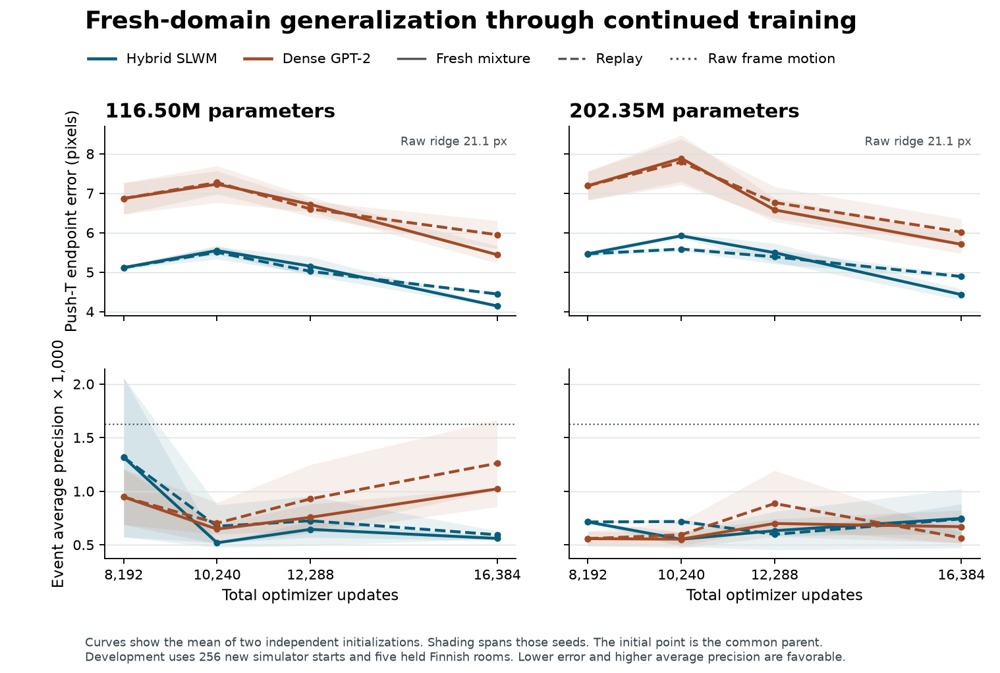

# G7 matched multimodal continuation

Sixteen continuations reached 16,384 updates. The 116.50M and 202.35M hybrids each have an exactly parameter-matched dense GPT-2-style control. Each fresh/replay pair resumes identical weights and optimizer state at 8,192 updates. Both original seeds and all 48 continuation milestones passed independent readback from two physical checkpoint drives.

The two named Google assignments used 24.48 estimated Colab compute units in total (7.92 single-chip hours). The 100-unit allowance applies to these assignments. Data preparation, alignment, simulation and held-out evaluation ran on Fedora. [Project-only ledger](metrics/project-compute.json) · [Checkpoint hashes](metrics/checkpoint-inventory.json)

## What the scale intervention changed

The 202.35M hybrid still had optimization headroom on action prediction at update 8,192. Replaying the original mixture changed held endpoint error by -0.58 / -0.46 pixels across the two seeds. The large dense control changed by -1.06 / -0.87 pixels under the same continuation. Negative changes mean lower error.

At a fixed exposure of 16,384 updates, fresh examples lowered endpoint error in 8 of eight architecture–size–seed comparisons. 8 paired 95% scene intervals excluded zero in that direction. For the large hybrid specifically, fresh minus replay was -0.36 / -0.51 pixels. On independent FineWeb documents, fresh training lowered next-byte NLL in 8 of eight comparisons.

At equal exposure, the large fresh hybrid minus the smaller fresh hybrid was 0.15 / -0.03 pixels on 512 held starts. At common continuation TPU time the corresponding original-development differences were 0.99 / 0.80 pixels. These comparisons use different evaluation sets and are reported separately. Two sizes and two seeds bound the strength of any scaling-law claim. [Matched estimates and uncertainty](metrics/matched-contrasts.json)

## Equal exposure on independent simulator starts

Each number is seed 511 / 512. Lower endpoint error in pixels is better. The final held set has 512 fresh Push-T starts. The raw ridge fits only original training scenes.

| Parameters | Core | Parent at 8,192 | Replay at 16,384 | Fresh at 16,384 | Raw ridge |
|---|---|---:|---:|---:|---:|
| 116.50M | Hybrid | 5.26 / 5.28 | 4.77 / 4.87 | 4.38 / 4.41 | 20.99 |
| 116.50M | Dense GPT-2 | 6.65 / 7.33 | 6.02 / 6.43 | 5.48 / 5.89 | 20.99 |
| 202.35M | Hybrid | 5.47 / 5.34 | 4.89 / 4.89 | 4.53 / 4.38 | 20.99 |
| 202.35M | Dense GPT-2 | 7.65 / 6.98 | 6.59 / 6.11 | 6.07 / 5.66 | 20.99 |

## Event transfer to the held Tokyo site

Average precision is multiplied by 1,000. Higher values are better. This site has two held rooms. The raw control uses absolute frame motion.

| Parameters | Core | Parent | Replay | Fresh | Raw motion |
|---|---|---:|---:|---:|---:|
| 116.50M | Hybrid | 12.93 / 0.72 | 25.28 / 0.78 | 25.33 / 1.43 | 1.93 |
| 116.50M | Dense GPT-2 | 0.72 / 0.85 | 0.80 / 0.96 | 0.77 / 0.93 | 1.93 |
| 202.35M | Hybrid | 0.86 / 25.22 | 1.34 / 1.04 | 0.83 / 1.02 | 1.93 |
| 202.35M | Dense GPT-2 | 0.89 / 0.80 | 0.84 / 0.81 | 0.76 / 0.68 | 1.93 |

## Text and cross-modal prediction

Held text is measured in conditional byte negative log-likelihood on 512 independent FineWeb documents. Lower values are better. Audio-to-text retains the same teacher-forced previous-byte bigram for the correct and sensor-erased controls. Speech and image losses use the same units for all arms.

| Parameters | Core | FineWeb parent | FineWeb replay | FineWeb fresh | Fresh CREMA video-to-audio MSE |
|---|---|---:|---:|---:|---:|
| 116.50M | Hybrid | 1.324 / 1.323 | 1.285 / 1.284 | 1.278 / 1.276 | 0.271 / 0.277 |
| 116.50M | Dense GPT-2 | 1.400 / 1.406 | 1.338 / 1.348 | 1.329 / 1.341 | 0.314 / 0.279 |
| 202.35M | Hybrid | 1.331 / 1.329 | 1.285 / 1.284 | 1.277 / 1.275 | 0.265 / 0.276 |
| 202.35M | Dense GPT-2 | 1.456 / 1.428 | 1.371 / 1.355 | 1.362 / 1.349 | 0.280 / 0.304 |

## Equal TPU time

The following comparison holds the continuation update-compute time at the longest duration bracketed by both sizes, including first-block compilation. Each entry is larger minus anchor on the original development Push-T endpoint. Negative favors the larger model. The held tests above use measured checkpoints at equal exposure.

| Core | Arm | Time in minutes, seed 511 / 512 | Endpoint difference in pixels |
|---|---|---:|---:|
| Hybrid | replay | 13.0 / 13.0 | 0.63 / 0.40 |
| Hybrid | fresh | 12.8 / 12.8 | 0.99 / 0.80 |
| Dense GPT-2 | replay | 13.4 / 13.4 | 1.36 / 0.11 |
| Dense GPT-2 | fresh | 13.2 / 13.3 | 1.71 / 0.43 |

The full tables include the size-by-data interaction, whole-scene/room paired intervals, alternative clocks including evaluation wall time, and interpolated step counts. The common-time estimates are linear interpolations between registered checkpoints. Per-arm time excludes off-device archiving. Actual paid time includes data staging and draining. [Paired contrasts](metrics/matched-contrasts.json) · [All curve points and negative controls](metrics/scale-curves.json)

## Shared state, speech and decisions

Each continuation saw 2,097,152 additional examples. The fresh arm changed 752,149 while preserving modality masks. Audio, video, numeric state and text all contributed. Four of the nine families remained replay anchors. Two replaced families introduced a domain shift as well as fresh examples. [Data and modality exposure](physical-time.md)

Four-way audiovisual alignment on 14 previously unseen speakers reached 43–44% through the hybrid and 40–43% through dense GPT-2. A matched head on the raw sensors reached 65–69%. Correct units still produced 85% acted-speech and 99% audiobook word error. The signed-time and waveform controls identify losses at different stages. [Physical-time confirmation](physical-time.md) · [Waveform oracle](alignment-and-control.md)

All four supervised policies retained useful goal history. None of the four RL policies met its predeclared improvement criterion. Two-step exact planning succeeded in 45–48% of episodes across two diagnostic cohorts. The learned two-step planner lost this gain even when supplied raw state and the retained cue. The earlier hybrid camera-substitution effect did not replicate on Reacher. [Transfer and planning](transfer-and-planning.md)

## Continuous inference and custody

The same 116.50M seed and first held Finnish recording were designated for both architectures and both data arms. Each input drives 1,024 consecutive ticks (43.69 seconds) with carried state. The public previews contain generated tracks. Video is a 16×16 grayscale prediction, displayed at a larger size. Prompt-conditioned clips expose changes in the model's output. The waveform and contact evaluation establish what those changes convey.

| Source and generated output | Hybrid, fresh | Dense GPT-2, fresh |
|---|---|---|
| Audio → video | [Watch](examples/hybrid/audio-to-video.webm) | [Watch](examples/gpt2/audio-to-video.webm) |
| Video → audio | [Listen](examples/hybrid/video-to-audio.ogg) | [Listen](examples/gpt2/video-to-audio.ogg) |
| Text → audio and video | [Watch and listen](examples/hybrid/text-to-audio-video.webm) | [Watch and listen](examples/gpt2/text-to-audio-video.webm) |

Artifacts for every fit are indexed under the Fedora paths `/mnt/slwm-checkpoints-a/SLWM/g7` and `/mnt/slwm-checkpoints-b/SLWM/g7`. Each `g7-v5e-*/step-016384` contains `inference.npz`, `resume.npz`, the configuration and verification receipt. The source data and preprocessing caches are on the separate SSD under `/mnt/slwm-data/SLWM/g7`. [Inference receipts](metrics/continuous-generation.json) · [Input recording source](https://doi.org/10.5281/zenodo.7880637) · [Run protocol](protocol.md)
