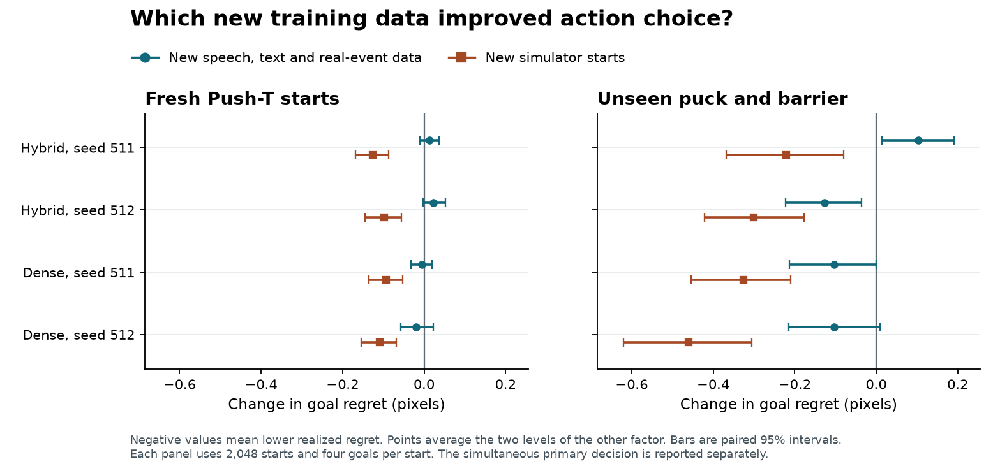

# G8 factorial transfer results

The hybrid missed the prespecified cross-modal decision-transfer criterion. Fresh non-simulator examples changed realized goal regret by 0.013 / 0.023 pixels on new Push-T starts and 0.103 / -0.126 pixels on the previously unseen puck-and-barrier dynamics. Negative changes favor fresh data. The simultaneous one-sided criterion held in 1 of four required task–seed cells.

Changing simulator starts independently changed hybrid regret by -0.126 / -0.098 pixels on Push-T and -0.220 / -0.300 on the puck task. These interventions separate physical training diversity from a bundle of acted speech, audiobooks, text documents and real audiovisual events. Two of the four non-simulator replacements also introduce a domain shift. Every cell still trains on all nine families. These estimates measure the incremental value of replacing examples in the specified families. A separate modality-ablation experiment would be needed to measure the value of including a family at all.

Eight new 116,502,025-parameter continuations reached 16,384 updates. Four 2,048-update bridge trials reproduced the archived inference and optimizer bytes exactly. Eight G7 corners and four G6 parents therefore qualified as controls. Each new fit resumed the same seed-specific parent at 8,192 updates and saw 2,097,152 additional examples at effective batch 256. The single named v5e-1 cost 8.90 units. Cumulative G7 and G8 usage was 33.38 of the authorized 100. [Protocol](protocol.md) · [Bridge hashes](metrics/bridges.json) · [Training and archive inventory](metrics/artifact-inventory.json)

## Equal-exposure decisions

Each cell shows the two training seeds in order. On each zero-shot panel, all models received the same observations, counterfactual candidate plans and independently sampled goals. Regret is excess realized goal distance over the best offered plan. Endpoint error is evaluated separately. Both are in pixels.

| Panel and metric | Core | G6 parent | Replay | Fresh sim only | Fresh other only | Both fresh |
|---|---|---:|---:|---:|---:|---:|
| Push-T regret | Hybrid | 0.53 / 0.53 | 0.51 / 0.45 | 0.38 / 0.37 | 0.52 / 0.49 | 0.40 / 0.38 |
| Push-T regret | Dense GPT-2 | 0.65 / 0.76 | 0.63 / 0.70 | 0.53 / 0.56 | 0.61 / 0.65 | 0.53 / 0.58 |
| Push-T endpoint | Hybrid | 5.76 / 5.73 | 5.29 / 5.23 | 4.80 / 4.72 | 5.35 / 5.18 | 4.77 / 4.71 |
| Push-T endpoint | Dense GPT-2 | 6.91 / 7.82 | 6.23 / 6.93 | 5.81 / 6.27 | 6.24 / 6.78 | 5.70 / 6.21 |
| Puck + barrier regret | Hybrid | 7.45 / 7.22 | 7.45 / 7.44 | 7.21 / 7.23 | 7.53 / 7.40 | 7.34 / 7.01 |
| Puck + barrier regret | Dense GPT-2 | 7.01 / 7.70 | 7.27 / 7.64 | 7.02 / 7.13 | 7.24 / 7.49 | 6.84 / 7.08 |
| Puck + barrier endpoint | Hybrid | 41.23 / 39.61 | 43.11 / 41.55 | 42.66 / 41.44 | 42.89 / 40.94 | 42.27 / 41.03 |
| Puck + barrier endpoint | Dense GPT-2 | 42.01 / 42.79 | 42.35 / 42.37 | 41.89 / 41.95 | 42.18 / 42.16 | 42.00 / 41.84 |

A separate fixed-pose audit found that removing the thin wall changed zero native camera pixels at all 64 development poses. Area averaging the same render made the wall visible. In another 512 pairs with matching histories and a hidden wall state, an oracle forced to choose the same plan incurred 0.87 pixels of excess regret (95% interval 0.75–1.00). The paired bound concerns that supplementary mixture. The registered puck panel always contains the barrier. [Visibility and paired-world controls](observation-check.md)

## Which data changed the decision?

The simple effects compare fixed simulator training data. The average non-simulator effect is the mean of other-minus-replay and both-minus-sim. The interaction is both minus sim minus other plus replay. Brackets give 4,000-draw, whole-start paired 95% intervals. The four primary simultaneous upper bounds use the 98.75th percentile and include both hybrid seeds and tasks.

| Panel | Core and seed | Other effect, old sim | Other effect, new sim | Average other effect | Interaction |
|---|---|---:|---:|---:|---:|
| Push-T | hybrid 511 | +0.013 [-0.025, +0.052] | +0.013 [-0.013, +0.040] | +0.013 [-0.010, +0.037] | -0.000 [-0.046, +0.047] |
| Push-T | hybrid 512 | +0.040 [+0.001, +0.081] | +0.005 [-0.025, +0.041] | +0.023 [-0.002, +0.052] | -0.035 [-0.085, +0.014] |
| Push-T | gpt2 511 | -0.017 [-0.056, +0.025] | +0.004 [-0.029, +0.036] | -0.006 [-0.032, +0.020] | +0.021 [-0.030, +0.073] |
| Push-T | gpt2 512 | -0.052 [-0.106, +0.005] | +0.014 [-0.032, +0.064] | -0.019 [-0.057, +0.023] | +0.066 [+0.003, +0.131] |
| Puck + barrier | hybrid 511 | +0.078 [-0.049, +0.205] | +0.129 [+0.012, +0.239] | +0.103 [+0.015, +0.191] | +0.051 [-0.115, +0.216] |
| Puck + barrier | hybrid 512 | -0.037 [-0.177, +0.094] | -0.216 [-0.348, -0.088] | -0.126 [-0.223, -0.037] | -0.179 [-0.363, +0.012] |
| Puck + barrier | gpt2 511 | -0.032 [-0.186, +0.113] | -0.176 [-0.320, -0.033] | -0.104 [-0.213, +0.000] | -0.145 [-0.342, +0.053] |
| Puck + barrier | gpt2 512 | -0.153 [-0.319, +0.008] | -0.054 [-0.196, +0.086] | -0.104 [-0.214, +0.009] | +0.099 [-0.112, +0.312] |

Uniform choice incurred 15.39 pixels on Push-T and 15.64 on the puck-and-barrier task. A geometry ridge fitted only on original training scenes incurred 2.70 and 6.86 pixels. The fresh panels contain 2,048 starts and four goals per start each. Full tables include state alone, correct and wrong camera, plan erasure, exact paired hybrid-versus-dense contrasts and the parent for every case. [All contrasts](metrics/factorial.json) · [Per-start primary arrays](metrics/paired-scenes.npz)

## Transfer to another simulator and action interface

The MuJoCo Reacher head fits 512 training starts for each frozen field and ranks nine realized torque trajectories on 512 independent starts. Both goals are scored on decisions two through four. This is supervised transfer with a matched label budget. Units are centimetres of regret.

| Core | Parent | Replay | Fresh sim | Fresh other | Both fresh | Average other effect |
|---|---:|---:|---:|---:|---:|---:|
| hybrid | 8.98 / 9.33 | 8.74 / 9.10 | 8.91 / 9.33 | 9.02 / 9.16 | 8.77 / 8.79 | 0.067 / -0.236 |
| gpt2 | 9.88 / 10.03 | 9.85 / 9.95 | 9.82 / 9.94 | 9.92 / 9.79 | 9.97 / 9.84 | 0.110 / -0.128 |

The raw-observation heads incurred 2.55 / 2.44 cm and the matched-data, body-frame physical prior incurred 0.17 cm. [Raw controls and head measurements](metrics/raw-and-live.json)

## Sustained operation

Each controller made 24 consecutive decisions and executed 384 physical ticks. The 64 starts per task and the proposal RNG were paired. The goal-aware proposal generator is shared by every controller. Each prediction uses the latest 16 observed ticks. Report terminal success inside a 20-pixel radius separately from ever reaching that radius.

| Task | Core | Replay success | Fresh sim | Fresh other | Both fresh | Both fresh terminal distance |
|---|---|---:|---:|---:|---:|---:|
| Push-T | hybrid | 0.0 / 0.0% | 1.6 / 1.6% | 1.6 / 1.6% | 0.0 / 0.0% | 272.68 / 280.44 px |
| Push-T | gpt2 | 0.0 / 0.0% | 0.0 / 0.0% | 0.0 / 0.0% | 0.0 / 0.0% | 260.04 / 267.85 px |
| Puck + barrier | hybrid | 0.0 / 0.0% | 0.0 / 0.0% | 0.0 / 0.0% | 0.0 / 0.0% | 270.27 / 293.16 px |
| Puck + barrier | gpt2 | 0.0 / 0.0% | 0.0 / 0.0% | 0.0 / 0.0% | 0.0 / 0.0% | 264.55 / 270.16 px |

| Task | First goal-directed proposal | Uniform choice | Passive | Geometry prior | Geometry terminal distance |
|---|---:|---:|---:|---:|---:|
| Push-T | 0.0% | 1.6% | 1.6% | 0.0% | 258.11 px |
| Puck + barrier | 0.0% | 0.0% | 0.0% | 0.0% | 264.44 px |

A post hoc mechanism check used 64 additional starts per task. It reconstructed and executed every candidate before making a greedy choice. This tests the candidate bank and one-decision horizon with perfect dynamics. The cohorts are distinct from the learned-controller evaluation.

| New cohort | First proposal | Passive | Exact greedy, three proposals | Exact greedy, plus hold | Paired final-success change from adding hold |
|---|---:|---:|---:|---:|---:|
| Push-T | 1.6% | 0.0% | 3.1% | 1.6% | -1.6 pp [-6.3, +3.1] |
| Puck + barrier | 0.0% | 0.0% | 0.0% | 7.8% | +7.8 pp [+1.6, +15.6] |

[Independent oracle protocol](live-oracle-protocol.md) · [Fresh-episode oracle measurements](metrics/artifact-inventory.json)

The previews replay the measured actions on the first predetermined start. Every decision endpoint is compared numerically with its saved trajectory. The replays show a higher-resolution scene and a red goal overlay for the viewer. The models received the registered 16×16 camera and observed state. [Push-T replay](examples/pusht.webm) · [Puck-and-barrier replay](examples/puck_barrier.webm) · [Replay hashes and error](metrics/rollout-examples.json) · [Run decision inference on the supplied observation](inference/decisions.md)

## Other modalities

This secondary panel reuses the fixed G7 held examples. Byte NLL is lower when next-byte predictions improve. Video-to-audio feature MSE and real-event AP are diagnostic losses; waveform intelligibility was measured independently.

| Core and seed | Replay byte NLL | Sim only | Other only | Both fresh | Both fresh video→audio MSE | Both fresh Tokyo event AP |
|---|---:|---:|---:|---:|---:|---:|
| hybrid 511 | 1.2848 | 1.2851 | 1.2774 | 1.2781 | 0.271 | 0.02533 |
| hybrid 512 | 1.2835 | 1.2831 | 1.2758 | 1.2759 | 0.277 | 0.00143 |
| gpt2 511 | 1.3384 | 1.3372 | 1.3302 | 1.3289 | 0.314 | 0.00077 |
| gpt2 512 | 1.3481 | 1.3479 | 1.3410 | 1.3413 | 0.279 | 0.00093 |

Separate rate-controlled experiments on fresh readers found a practical acoustic decoder. At 2,250 bits/s, trained bit allocation cut WER from 93.5% to 46.7%. At 9,000 bits/s WER was 22.5%, close to the original audio’s 22.4%. A whole-utterance replication on 40 further readers met the ±3-point recognition margin at 9 kbit/s for two recognizers. The frozen world-state readouts still failed the genuine text/video-to-waveform content criterion. [Speech evidence and examples](speech.md) · [Portable weights and decoder instructions](inference/README.md)

## What to investigate next

Keep the physical trajectories matched and add synchronized observations whose information actually changes the best action. Use paired scenes with identical apparent state but a different physical condition, a sensor that reveals that condition, and an oracle showing that choosing differently improves realized return. The present study does not establish replicated cross-modal decision transfer under its registered criterion.

Use the demonstrated acoustic codec as a downstream reference while testing shorter-timescale supervision and alternate alignment objectives in the shared field. Require prediction of recoverable words under correct, wrong and erased inputs before optimizing listener preference.

All 24 newly trained optimizer and inference generations have independent physical readback. Large files are stored under `/mnt/slwm-checkpoints-a/SLWM/g8` and `/mnt/slwm-checkpoints-b/SLWM/g8`. Confirmation data are on the separate Fedora SSD. [Compute and release receipt](metrics/release.json) · [Complete G7 study](../../t7/continuation-alignment-control-20261110/report.md)
