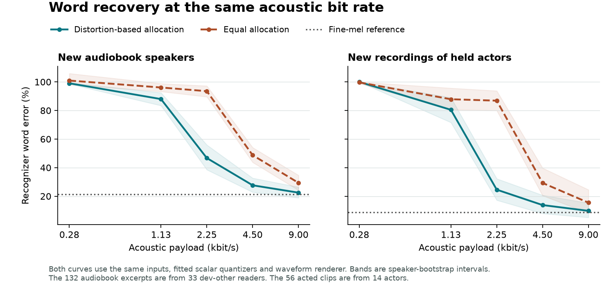

# Acoustic information, compression and cross-modal generation

A train-fitted codec recovered substantially more speech at the same physical bit rate when it spent more bits on the acoustic components that contributed the most reconstruction error. On 132 excerpts from 33 new audiobook readers, word error fell from 93.5% to 46.7% at 2,250 bits/s. The speaker-paired 95% interval for the reduction was 36.5–55.7 percentage points. The frozen waveform renderer and recognizer, quantizer centers, training population, timing and total payload were identical in these two conditions. [Controlled design](rate-followup.md) · [All measured outcomes and intervals](metrics/speech.json)

| Input to the fixed recognizer | Audiobooks, 33 new readers | Acted speech, 14 held actors |
|---|---:|---:|
| Original audio | 22.4% | 6.7% |
| Fine acoustic features through Vocos | 21.4% | 8.8% |
| Continuous 64-component PCA through Vocos | 22.5% | 9.8% |
| Initial product code at 2,250 bits/s | 92.5% | 80.5% |
| Equal scalar allocation at 2,250 bits/s | 93.5% | 86.9% |
| Optimized allocation at 2,250 bits/s | 46.7% | 24.6% |
| Optimized allocation at 4,500 bits/s | 27.6% | 13.8% |
| Optimized allocation at 9,000 bits/s | 22.5% | 9.8% |

The comparison uses fixed-width symbol fields and an actual bit-pack/unpack round trip. Dynamic programming chooses the component widths using observed training distortion. The optimized 48-bit allocation uses the same six-byte payload per 21.33 ms frame pair as its equal-allocation control. The 651,696-byte model and the stream header are accounted for separately. At 9,000 bits/s recognition on this panel approached the fine-feature reference. Perceptual quality and speaker identity have separate evaluation requirements. [Downloadable codec and usage](inference/README.md)

## What the shared state generated

The initial product quantizer retained 98.2% of training spectral variance in its continuous PCA basis. Its eight-group oracle still produced 100.1% WER on the first independent 33-reader test-other cohort, versus 25.5% for original audio. The separate dev-other cohort above was selected and verified after that result. It has no speakers in common with the first cohort or G7 training. The acted holdout uses different clips of the same 14 actors between the two experiments. Each cohort's first four clips per speaker were selected by a fixed identifier hash. [Initial experiment](speech-protocol.md) · [Source and license](https://www.openslr.org/12/)

Four matched, 2,048-update readouts then forecast continuous acoustic coefficients from the same frozen 116.50M G6 hybrid and dense representations used in the earlier alignment study. On dev-other, text-conditioned generated waveforms remained near 99% word error. On acted speech, video-conditioned output also remained near 100%. Neither architecture passed the replicated correct-versus-wrong and correct-versus-erased waveform criterion. An improved **observed-audio** decoder therefore localizes a separate failure in how much recoverable content these frozen fields and fitted heads supply.

When the original sound outside a missing span was copied into the result, raw interpolation gave 53.2% audiobook word error. The two hybrid repairs gave 51.4% and 52.0%. Both speaker-paired intervals for the change included zero, as did the dense controls. Copying the available context and predicting an entire waveform answer different questions. [Per-direction conditions and independent head hashes](metrics/speech.json)

## Replication on complete utterances

A third panel used 80 whole test-clean utterances from 40 additional readers, totaling 1,954 reference words and 719.9 seconds. All readers were disjoint from both preceding G8 audiobook panels and G7 training. Selection used only speaker, a fixed identifier hash and a 4–18-second duration range. Neither recognizer selected the clips or word boundaries. The codec and both recognizers were frozen. [Prospective replication protocol](full-utterance-protocol.md) · [Paired edit counts and speaker intervals](metrics/full-utterance.json)

| Recognizer | Original audio | Fine-mel reference | Equal at 2.25 kbit/s | Optimized at 2.25 kbit/s | Optimized at 9 kbit/s |
|---|---:|---:|---:|---:|---:|
| Whisper-tiny.en | 5.7% | 6.3% | 73.0% | 11.1% | 6.6% |
| wav2vec2-base-960h CTC | 9.0% | 9.4% | 79.8% | 18.7% | 10.5% |

At the same 2,250-bit/s rate, both speaker-paired intervals excluded zero in favor of the optimized allocation. Relative to original audio, the 9 kbit/s stream increased WER by 0.87 points for Whisper (95% interval +0.11 to +1.70) and 1.54 points for CTC (+0.41 to +2.94). Both intervals met the registered ±3-point recognition margin. This measures compression of observed audio on this speech population. It leaves the failure of text- and video-conditioned generation intact.

## Inference examples

The long example concatenates adjacent published utterance files from one held LibriSpeech chapter, retaining 48 seconds in chapter order. The compressed files contain 13,500 and 54,000 payload bytes at 2,250 and 9,000 bits/s, respectively. The decoded WAVs have exactly 1,152,000 samples at 24 kHz. The listening previews use Opus for convenient playback. The public model can decode the original experiment streams. [Example IDs, source description, sample clocks and file hashes](metrics/speech-examples.json)

| Source and output | Artifact |
|---|---|
| Observed audio, 2.25 kbit/s acoustic stream | [Listen for 48 seconds](examples/speech/chapter-48.ogg) · [Packed stream](examples/speech/chapter-48.slwma) |
| Observed audio, 9 kbit/s acoustic stream | [Listen for 48 seconds](examples/speech/chapter-192.ogg) · [Packed stream](examples/speech/chapter-192.slwma) |
| Text-only input, whole-waveform prediction | [Listen](examples/speech/text-conditioned.ogg) |
| Video-only input, whole-waveform prediction | [Listen](examples/speech/video-conditioned.ogg) |

The last two examples use the first predetermined utterance in their respective confirmation sets and the first hybrid seed. Their models receive the declared text or video source. The compressed examples above them receive source audio.
