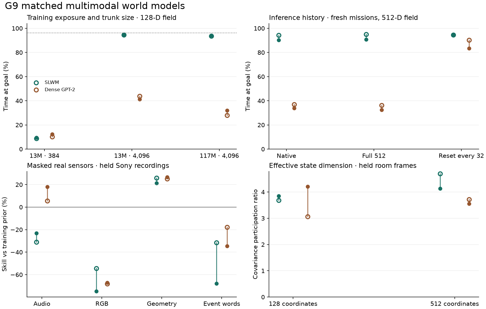

# G9 shared state, training exposure and sustained decisions

On held 51.2-second missions, the 13M hybrid learned to use a past calibration tap, reach a requested station and hold position through changing goals. At 4,096 updates its 128-coordinate field reached **94.5 / 94.8%** goal occupancy across the two training seeds. The equal-parameter dense GPT-2-style model reached **43.8 / 41.2%**. A physical controller that knew how to decode the same sensors reached 96.24%. Holding forever reached 6.54%. The learned advantage is concentrated in this persistent-control setting. Recorded multimodal transfer gives a different ordering.

Open and filled points show seeds 911 and 912. The dotted line in the first panel marks the sensor-based controller. Positive skill in the real-sensor panel means lower loss than the training prior.

## Exposure and width

All figures below are percentages of time at the active goal. Each cell shows independent training seeds 911 and 912 on the same 128 held missions. The held simulator uses previously unused mission seeds. Layouts and actuator signs come from the same families as training, and the intermittent motor-stall rule is held out. Each core issued its own controls for 512 successive ticks. Matched architectures share initial common matrices, training examples, masking draws and parameter counts within a field width.

| Trunk and training | Emitted coordinates | SLWM | Dense GPT-2 |
| --- | ---: | ---: | ---: |
| 13M, 384 updates | 128 | 8.8 / 9.5 | 10.2 / 12.4 |
| 13M, 384 updates | 512 | 7.8 / 7.8 | 9.9 / 11.5 |
| 13M, 4,096 updates | 128 | 94.5 / 94.8 | 43.8 / 41.2 |
| 13M, 4,096 updates | 512 | 92.8 / 94.3 | 30.9 / 40.5 |
| 117M, 4,096 updates | 128 | 93.5 / 94.1 | 28.1 / 31.9 |
| 117M, 4,096 updates | 512 | 94.6 / 91.1 | 39.0 / 32.1 |

At equal 4,096-update exposure, the large-minus-small SLWM change for the 128-coordinate field was -1.0 [-1.5, -0.5] / -0.7 [-1.2, -0.3] percentage points. Moving the large SLWM from 128 to 512 coordinates changed occupancy by +1.0 [+0.6, +1.5] / -3.0 [-4.2, -1.9] points. The full-size 128-coordinate SLWM-minus-dense differences were +65.5 [+64.0, +66.9] / +62.2 [+60.6, +63.9]. Intervals resample entire missions 4,000 times within each training seed. Exposure and optimization explain the early failure of the small hybrid on this task. The small and large fresh runs consumed about 1.27 and 0.14 sampled clock positions per parameter.

## Independent data at equal training exposure

| 13M wide-field model, 4,096 updates | 393,216 independent starts | Replay of 2,048 starts |
| --- | ---: | ---: |
| SLWM | 92.6 / 94.2% | 15.2 / 17.7% |
| Dense GPT-2 | 29.8 / 41.1% | 14.6 / 13.5% |

At 384 updates, 36,864 fresh simulator episodes versus replay of 2,048 episodes gave a hybrid occupancy change of -1.0 [-2.5, +0.6] / -3.5 [-5.3, -1.8] points. The short screen gave no replicated benefit from the larger episode pool at fixed update count. At 4,096 updates and 393,216 fresh versus 2,048 replayed starts, the independent-cohort fresh-minus-replay occupancy differences were +77.4 [+75.9, +78.9] / +76.5 [+74.8, +78.3] points for SLWM and +15.1 [+13.1, +17.1] / +27.6 [+25.8, +29.4] for dense GPT-2. The real recordings, masks, number of updates and starting parameters were identical within each comparison. [Independent-dose registration](data-dose.md) The table uses a new cohort of 128 missions. The long-dose test was registered after observing the short-screen floor.

## Why history matters

In the primary large 128-coordinate hybrid, resetting memory on every observation yielded 20.1 / 18.4% occupancy. Reversing the sign of the previously issued tap yielded 20.3 / 14.7%. On paired histories with identical audio, video, physical and word streams, the issued tap was the only distinguishing input. SLWM selected the correct final action in 100.0 / 100.0% of cases. Dense GPT-2 reached 80.5 / 77.7%.

A separate cohort changed only inference. The large wide-field hybrid reached 94.4 / 90.2% with the native 64-step attention cache and 94.9 / 90.6% with a full 512-step cache. Dense GPT-2 reached 36.9 / 33.8% and 36.2 / 32.6%. Resetting **both** architectures every 32 ticks, matching the training sequence length, gave 94.6 / 94.4% for SLWM and 90.2 / 83.3% for dense GPT-2. The remaining paired gap was +4.4 [+2.6, +6.4] / +11.1 [+8.4, +13.9] points. Context-length mismatch explains a substantial part of the native dense deficit. Native per-world layer caches occupied 720,576 bytes for SLWM and 2,753,280 bytes for dense GPT-2. These counts cover recurrent states, keys, values and validity masks. [Individual memory interventions](memory-and-adaptation.md)

## What the recorded modalities carry

Every training window has a common 10 Hz clock. Each step can contain 64 spectral measurements, a 16×16 RGB image, 12 physical channels and eight small-vocabulary word slots. Before masking, all streams are available. In seed 911, 50.02% of training windows had all four visible. Three quarters of rows are simulated and one quarter come from 50 STARSS23 recordings spanning seven training rooms and 2.87 hours. At 4,096 steps there are 393,216 independent simulated starts and 16,777,216 sampled clock positions. The real draws visit 73,709 distinct overlapping window starts and 103,278 distinct recorded ticks. The same room, static board image or repeated goal word can contribute many measurements while adding little independent information.

We withheld the target throughout each window on 30 Sony recordings from two held rooms. The aligned and half-recording-shifted conditions use identical source masks. Lower loss is better. The prior uses training statistics. The word targets name annotated events.

| Target | SLWM aligned | SLWM shifted | Dense aligned | Dense shifted | Prior |
| --- | ---: | ---: | ---: | ---: | ---: |
| Audio log-band MSE | 0.1215 / 0.1142 | 0.1273 / 0.1202 | 0.0877 / 0.0760 | 0.0909 / 0.0827 | 0.0928 |
| RGB MSE | 0.1712 / 0.1939 | 0.1756 / 0.1984 | 0.1865 / 0.1855 | 0.1913 / 0.1913 | 0.1110 |
| Normalized physical-channel MSE | 0.0105 / 0.0111 | 0.0117 / 0.0124 | 0.0106 / 0.0104 | 0.0118 / 0.0115 | 0.0142 |
| Event-word binary cross-entropy | 0.3996 / 0.5103 | 0.4455 / 0.5401 | 0.3579 / 0.4093 | 0.3947 / 0.4386 | 0.3040 |

Both architectures improved on the training prior for tracked geometry. Dense GPT-2 also improved on the audio prior in both seeds. The prior had lower RGB and event-word loss than either wide model, even though correct timing improved all four target losses over the shifted-source control.

The large hybrid's held-room covariance participation ratios were 3.69 / 3.85 for 128 coordinates and 4.70 / 4.13 for 512. The corresponding dense values were 3.06 / 4.20 and 3.72 / 3.55. These describe variance on the held room panel. Testing whether events occupy common coordinates across sources requires a separate measurement. The 40-second audio-to-RGB, video-to-audio and event-word-to-both examples preserve that distinction. [View and listen](examples/README.md)

A separate within-recording retrieval test used all 28 available recordings in two further Sony rooms. Each single-source query selected among eight time windows of the same recording, with chance 12.5%. With a 512-coordinate field, direct audio-to-vision retrieval reached 9.4 / 8.9% for SLWM and 16.1 / 17.9% for dense GPT-2. After an orthogonal alignment fitted only to the TAU training recordings, those scores were 14.3 / 11.2% and 15.6 / 8.0%. This measures temporal correspondence beyond room identity. Event words and tracked-event counts share an annotation process, which can also produce an association. [Twelve directional comparisons and raw activity controls](metrics/invariance) · [Retrieval protocol](source-invariance.md)

The ROMA transfer panel froze every backbone and fitted a common ridge head on six calibration scenes. Tests used 36 trials from eighteen other scenes with timestamps joining contact audio, camera images, action names and force. The target was next-tick force while the physical input was withheld. On uncapped original targets, the two large wide hybrids and the two dense controls gave **7.08 / 7.79 / 7.16 / 7.69 N**, in that order. The training-mean reference gave 6.95 N, raw non-force sensors 7.10 N, and a reference allowed to see the current force 3.26 N. The mean baseline had lower error than all four wide parents on the original force range. The registered ±20 N range clipped at least one component in 18.4% of held ticks. [Original-range sensitivity](metrics/uncapped) · [Dataset and identifiers](metrics/inputs.json)

## Negative findings and next experiments

- Fixed-frequency Snake passed 2 of four wide-field development comparisons. The promotion rule required all four. A large periodic arm was therefore unnecessary under this protocol. This result applies to feed-forward Snake on these quantized input features.
- Fitting a 66,567-parameter decision head on 16,384 parent-visited states reduced fresh-cohort occupancy in all four wide large parents. In the two hybrids, 14,705 and 14,364 training labels requested hold, compared with 975 for random trajectories. Visit distribution changed materially. The experiment does not isolate label imbalance as the cause. [Head weights and controls](metrics/followups/heads)
- The four-layer gated recurrent control was tested at 384 updates. Its wide-field occupancy was 8.0 / 7.6%. Establish its equal-exposure performance and compare stronger recurrent baselines before generalizing the architecture ranking.

The next decision experiment is to train both architectures on matched 32–512-step context distributions at equal exposure, then test unpredictable goal changes and actuator recalibration. The next data investment is additional independently recorded, synchronized natural instructions, contacts and outcomes across sites. Test an alignment target that distinguishes the correct event from same-room, wrong-time evidence. Require better direct retrieval and conditional prediction on new rooms while preserving the learned action memory. Keep whole sites and novel dynamics held, compare wrong-time and wrong-instruction inputs, and require performance above a physical and persistence reference. The action result supports sustained-memory research. The real cross-modal results justify more diverse grounded data before increasing the shared width again.

## Artifacts and compute

All 42 fits completed and 58 inference/optimizer generations were hash-verified on both Fedora checkpoint volumes. Native TPU and CUDA inference independently replayed the sixteen final equal-exposure and large models from identical weight hashes. The largest difference in mean goal occupancy between the backends was 0.87 percentage points. Each paired architecture comparison uses a common backend. A single changed action can change subsequent observations.

On the same TPU at 4,096 updates, median warm throughput was 188.5 updates/s for the small trunks and 35.7 for the large trunks, at 128 sequences of 32 ticks. Median elapsed training time, including compilation and checkpoint work, was 33.6 and 185.6 seconds per fit, respectively.

G9 used 4.12 project Colab units on a named v5e-1. The four-layer screen trained on the RTX 3090. Cumulative owned usage for G7–G9 was 37.50 of the 100-unit allowance. The G9 runtime was released. At release, the Google Drive mirror was backing off from its project query limit, with 0 G9 files verified there. The public packages give both complete small backbones and the exact inference CLI. The private optimizer stages and unquantized weights are indexed by tag, step and SHA-256. [Download and run](inference/README.md) · [Artifact inventory](metrics/artifacts.json) · [Paired observations](metrics/paired-observations.npz) · [Registered protocol](protocol.md) · [Full machine-readable results](metrics/results.json)
