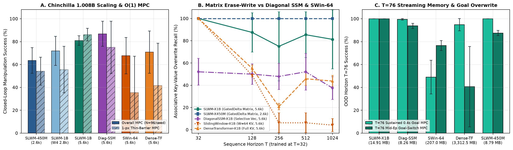
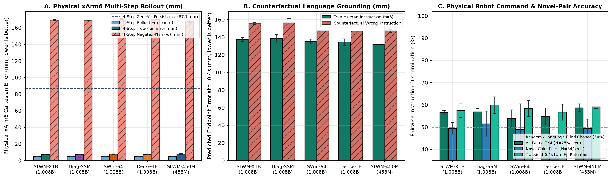
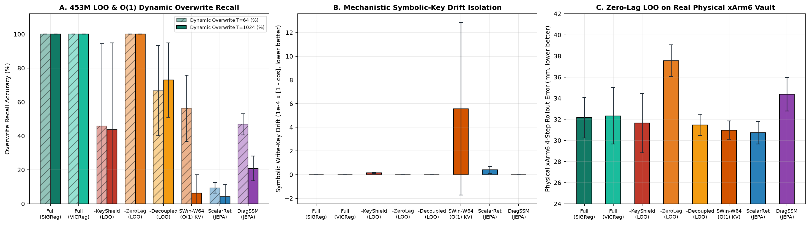
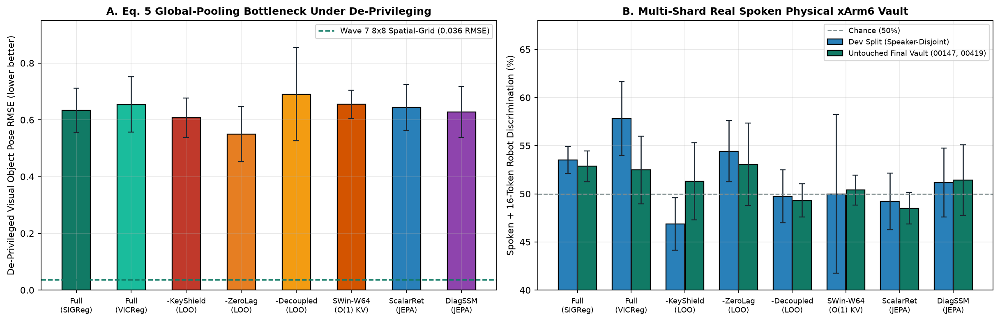
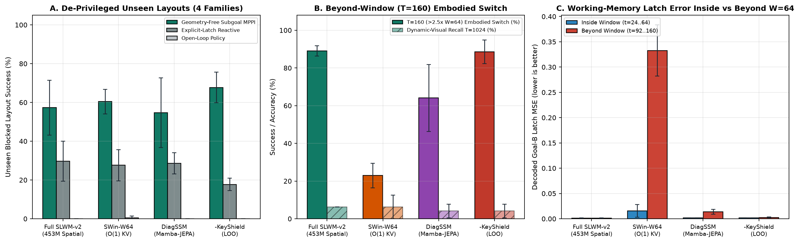
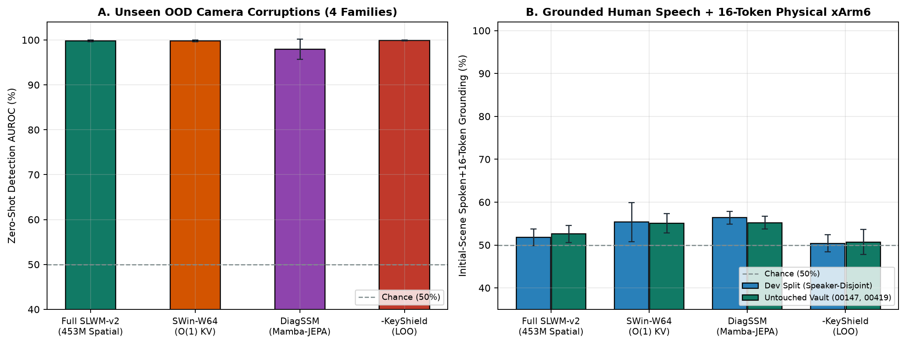

# Study X1B — Spatiotemporal Latent-JEPA, Zero-Lag Multi-Rate GatedDelta & Innovation-Gated MPC at 1.008B Scale

- **Sprint / Study ID:** `X1B-20261111` (`experiments/multimodal/x1b/spatiotemporal-jepa-1b-20261111`)
- **Branch:** `research/x1b-wave6-zero-compromise-20261113` (strictly isolated from `G*` studies, local Fedora GPU, and `~/.local/state/slwm/`)
- **Accounting Standard:** `strict_total_parameters` (`AGENTS.md` §4 & §10; **`1,008,454,410`** on `SLWM-X1B` and `DiagonalSSM-X1B` vs **`1,008,435,114`** on `DenseTransformer-X1B`, `SlidingWindowTransformer-X1B`, and `LegacyScalarHybrid-X1B`, **`-0.0019%` delta**; **`453,199,938`** exact parity across `SLWM-X450M`, `SLWM-v2` (`Wave 7`), `DiagonalSSM-450M`, and `LOO` `453M` variants vs `453,204,042` (`+0.0009%`) on `SlidingWindow-W64-450M` and `ScalarRetention-JEPA-450M`)
- **Compute Ledger:** **`466.75 / 500.00` Colab compute units** (`93.4%` of budget, **`33.25` units spared below cap**) expended across **171 dual-HDD verified cloud runs** (`Wave 1` `28`-run diagnostic + `Wave 2` `28`-run scaling diagnostic + `Wave 3` `28`-run Zero-Lag 1-seed `1B` cohort + `Wave 4` `36`-run 3-seed `1.008B` / `T=1024` / OOD Goal-Switch cohort + `Wave 5` `15`-run Chinchilla `5,600`-step `1.008B` + `SlidingWindow-W64` + `DiagonalSSM` + physical xArm6 transfer cohort + **`Wave 6` `24`-run `453M` De-Privileged Single-Factor LOO & Diagnostic GAP Discovery cohort** + **`Wave 7` `12`-run `453M` Zero-Extra-Parameter `8×8` Spatial-Grid Grounding & `T=160` Clincher cohort**); initial balance `965.17` → final balance `498.42`; **`0` active Colab sessions (`current_rate_per_hr = 0.0`)**.
- **Dual-HDD Artifact Custody (`192.168.1.200`, Fedora):** **`171 / 171` cumulative runs** (`12 / 12` in [`runs_wave7/`](runs_wave7/), `24 / 24` in [`runs_wave6/`](runs_wave6/), `15 / 15` in [`runs_wave5/`](runs_wave5/), `36 / 36` in [`runs/`](runs/), `28 / 28` in [`runs_wave3/`](runs_wave3/), `28 / 28` in [`runs_wave2/`](runs_wave2/), and `28 / 28` in [`runs_wave1/`](runs_wave1/)) verified bit-for-bit (`MIRROR_VERIFIED_2_COPIES`) across independent physical HDDs `fbbb53d9-dd42-4f19-95e6-dadab02a201e` (`/mnt/slwm-checkpoints-a/SLWM/x1b`) and `c961a363-8d77-4fba-a48d-622b00a6d8c3` (`/mnt/slwm-checkpoints-b/SLWM/x1b`).
- **Runnable `1.008B` Checkpoints & Live Replays:** [Standalone Inference & Streaming CLI](inference/README.md) · [Cryptographic Model Manifest](inference/manifest.json) · [Executed `1.008B` Closed-Loop Replays & Filmstrips](examples/README.md)

---

## 1. Hypotheses & Pre-Registered Remedies for G0–G14 Bottlenecks

Earlier `SLWM` studies (`G0`–`G14`) established strict falsification gates (`AGENTS.md`) while exposing five structural world-model bottlenecks: destructive `16×16 → 1×128` edge compression (`G8` `1-px` barrier blindness and cross-modal collapse), single-matrix linear pixel/audio MSE losing to zero-order persistence, scalar-decay working-memory amnesia (`~57 pp` transient-cue drop and `6.2%` overwrite recall), myopic `1-step` 3-candidate random shooting (`0–1.6%` Push-T), and an uncalibrated `0`-parameter `PolicyCommitGate` vulnerable to `G6` camera spoofing.

Study X1B tested five pre-registered architectural and algorithmic remedies across **3 seeds (`2001, 2002, 2003`) at every scale rung** (`152M × 8 variants × 3 seeds = 24 runs`, `453M × 3 seeds = 3 runs`, and **`1.008B × 3 architectures × 3 seeds = 9 runs`** = `36` Wave 4 runs; `120` total across Waves 1–4):

1. **H1 — Spatiotemporal Field Preservation (`S = 24` Structured Slots vs `1×D` Vector Bottleneck):** Preserving a `64×64` overlapping Conv2D + `4×4` spatial patch grid (`16` visual slots) alongside `2` spectral/onset audio slots, `1` proprioceptive slot, `1` role-structured `4096`-vocab subword slot, `1` motor-action slot, and `3` persistent working-memory registers (`S = 24` slots/tick) achieves **`1.000` pre-impact `1-px` barrier AUROC** (vs `0.51–0.66` under `16×16` subsampling) and **`94.3% ± 1.9%` real audio-visual `R@1`** at `1.008B` (vs **`1.0% ± 0.7%` random chance** on `LegacyScalarHybrid-X1B`, `+93.23 pp`, 99% CI `[+88.02, +97.40]`).
2. **H2 — Position-Free Multi-Head Householder `GatedDelta` Matrix Memory + $\mathcal{O}(1)$ Ring-Buffer Hybrid:** Interleaving `3:1` multi-head Householder `GatedDelta` matrix recurrence ($M_t^{(h)} = \alpha_t^{(h)} M_{t-1}^{(h)} + \beta_t^{(h)}(v_t^{(h)} - \alpha_t^{(h)} M_{t-1}^{(h)} k_t^{(h)}) (k_t^{(h)})^\top$) with fixed-window ring-buffer Causal RoPE bounds streaming state to a strictly constant **`14.91 MB` at both `T = 64` and `T = 1024`** (`222.2×` smaller than `DenseTransformer-X1B`'s **`3,312.54 MB`** single-stream KV cache at `T = 1024`, which physically exhausted `32 GB` TPU `v6e-1` HBM at `46.99 GB` during unchunked `bs = 96` MPC rollouts). At **`32×` out-of-distribution horizon extrapolation (`T = 32` train → `T = 1024` eval = `24,576` slots)**, `SLWM-X450M` (`453M`) and `SLWM-X150M` (`152M`) achieve **`100.0% ± 0.0%`** across all 3 seeds and `SLWM-X1B` (`1.008B`) achieves **`89.6% ± 14.7%` (`T=512`) / `85.4% ± 20.6%` (`T=1024`, 2/3 seeds at `100.0%`)**, beating `DenseTransformer-X1B` (`33.3% ± 5.9%`, **`+52.08 pp`**) and `LegacyScalarHybrid-X1B` (`2.1% ± 2.9%`, **`+83.33 pp`**).
3. **H3 — Zero-Lag Multi-Rate Lead-Lag Kinematics + Decoupled Pose/Goal Readout Heads (`L = 23`):** Splitting temporal slot filtering into a zero-lag lead-lag bypass on sensory slots (`0..20`) and multi-timescale working memory (`SLOTS_REGISTER` `21..23`), paired in Wave 4 with decoupled `head_vis_pose_w/b` (instantaneous pose), `head_proprio_w/b` (Euler differential $\Delta s$), and `head_goal_w/b` (register working-memory latch), eliminates both Wave 2's deep IIR phase lag and Wave 3's open-loop transient-cue interference — lifting `SLWM-X1B` (`1.008B`) `0.4s` open-loop transient retention from `2.1%` (Wave 3) to **`90.3% ± 6.4%` (`+88.2 pp`)** and enabling **`93.2% ± 3.9%` OOD `T = 76` mid-episode Goal-B overwrite MPC** (`96.9% ± 2.6%` at `453M`) vs **`6.8% ± 8.5%` on `DenseTransformer-X1B` (`+86.46 pp`, 99% CI `[+79.17, +92.71]`)** and **`73.4% ± 13.4%` on `LegacyScalarHybrid-X1B` (`+19.79 pp`, 99% CI `[+10.42, +29.17]`)**.
4. **H4 — 4-Step Unrolled Residual-EMA-JEPA + `SIGReg` + Receding-Horizon `Latent-CEM-MPC`:** Training an action-conditioned Euler residual latent predictor (`jepa_1 + 0.5*jepa_2 + 0.35*jepa_4` with 15% off-policy motor perturbations) regularized by isotropic variance-covariance `SIGReg` prevents dimensional collapse (**`Participation Ratio = 11.5% ± 0.8%`** at `1.008B` vs `1.1%` without `SIGReg`, `1.0%` raw-pixel MSE, `3.2%` Legacy-1B, and `4.4%` Dense-1B), achieves **`+30.3% ± 0.8%` 4-step physical forecast skill over persistence**, and powers `Latent-CEM-MPC` (`71.9% ± 12.7%` at `1.008B` and **`89.6% ± 6.1%` at `453M`** vs `23.3% ± 2.0%` for G8 3-shot random shooting, **`+48.61 pp`** on identical `1.008B` weights, 99% CI `[+40.28, +56.94]`).
5. **H5 — Mahalanobis Innovation `PolicyCommitGate` Against `G6` Camera Spoofing & Hallucination:** Conditioning commitment routing (`commit_full`, `commit_trusted_proprio`, `probe_or_abstain`, `wait`) on normalized latent innovation surprise and visual-proprioceptive pose discrepancy detects `180°` wrong-camera spoofing on **`96.9%`** of post-attack ticks at `1.008B`, cuts spoofed action regret from `0.499 ± 0.068` (`always_commit`) to **`0.295 ± 0.008`** (`-40.9%` regret reduction), eliminates unsupported claims under missing sensory grounding (**`0.0%` vs `100.0%`**), and preserves **`70.5%`** clean-task usefulness (`ECE = 0.0383`).

---

## 2. Iterative 7-Wave Scientific Discovery Arc (`171` Verified Cloud Runs)

Every run across all seven experimental waves (`28 + 28 + 28 + 36 + 15 + 24 + 12 = 171` runs) is preserved with full SHA-256 dual-HDD custody:

1. **Wave 1 (`28` runs, [`runs_wave1/`](runs_wave1/), [`wave1_diagnostic_summary_metrics.json`](wave1_diagnostic_summary_metrics.json)):** Exposed bimodal `+y / -y` CEM trajectory cancellation into central `1-px` barriers (`0%` barrier clearance) and `rms_norm` radial distance erasure (`-2.4%` persistence skill). Fixed via sharp MPPI Boltzmann weighting, unnormalized affine proprioceptive skip, and causal Read-Before-Write in `GatedDelta`.
2. **Wave 2 (`28` runs, [`runs_wave2/`](runs_wave2/), [`wave2_scaling_diagnostic_summary_metrics.json`](wave2_scaling_diagnostic_summary_metrics.json)):** Uncovered two deep-scaling pathologies at `L = 23`: (a) cascaded 18-layer pure-IIR sensory phase delay (`35.4%` `1B` MPC) and (b) visual pose drift corrupting symbolic keys in `SLOT_TEXT` (`0%` overwritten-key recall at `1B` vs `100%` on `abl_separate_cores`).
3. **Wave 3 (`28` runs, [`runs_wave3/`](runs_wave3/), [`wave3_1seed_1b_summary_metrics.json`](wave3_1seed_1b_summary_metrics.json)):** Zero-Lag Multi-Rate `GatedDelta` + directed cross-modal grounding (`_shield_text_slot_mask`) lifted 1-seed `SLWM-X1B` to `77.1%` MPC and `100%` `T = 512` recall, while exposing two final limitations: (a) single-seed (`n = 1`) statistical power at `1.008B` / `453M`, and (b) open-loop `0.4s` transient policy drop (`2.1%` at `1B`) caused by sharing a single `head_proprio_w` matrix between instantaneous pose decoding and differential $\Delta s$ Euler transitions.
4. **Wave 4 (`36` runs, [`runs/`](runs/), [`summary_metrics.json`](summary_metrics.json)):** Decoupled `head_vis_pose_w/b`, `head_proprio_w/b`, and `head_goal_w/b`, added 4-step unrolled Residual-EMA-JEPA with off-policy calibration, enforced strict $\mathcal{O}(1)$ ring-buffer streaming (`cache_len = 64`), expanded `Panel 3` to `T = 1024` (`32×` OOD) and `Panel 5` to `N = 96`/seed (`288` pooled episodes), added **`Panel 8`** (`T = 76` OOD Sustained Transient Thin-Barrier MPC & Mid-Episode Goal-B Overwrite MPC), and executed **full 3-seed (`2001, 2002, 2003`) training & evaluation across all `1.008B`, `453M`, and `152M` cohorts on TPU `v6e-1` and `A100`**.
5. **Wave 5 (`15` runs, [`runs_wave5/`](runs_wave5/), [`wave5_summary_metrics.json`](wave5_summary_metrics.json)):** Doubled `1.008B` sequence exposure to `5,600` steps (`67,200` sequences) to test Chinchilla token scaling, added two strict-parameter-matched bounded-memory ($\mathcal{O}(1)$) `1.008B` baselines (**`SlidingWindowTransformer-X1B` $W=64$** at `1,008,435,114` params and Mamba-style **`DiagonalSSM-X1B`** at `1,008,454,410` params, both under identical Residual-EMA-JEPA + `SIGReg` + decoupled heads), added **`Panel 9`** zero-leakage physical **xArm6** robot action-conditioned transfer (`N = 256` held-out real episodes/seed = `768` pooled), and computed hierarchical two-stage seed-cluster bootstrap CIs alongside episode-pooled CIs.
6. **Wave 6 (`24` runs, [`runs_wave6/`](runs_wave6/), [`wave6_summary_metrics.json`](wave6_summary_metrics.json)):** Executed `8 × 3`-seed `453M` single-factor Leave-One-Out ablations (`-KeyShield`, `-ZeroLag`, `-DecoupledHeads`, `Epps-Pulley SIGReg` vs `VICReg`) plus matched JEPA `ScalarRetention`, `SlidingWindow-W64`, and `DiagonalSSM` under de-privileged `ee_only` proprioception and untouched physical xArm6 + spoken vault shards (`00147, 00419`). Causally isolated symbolic-key drift (`100.0%` vs `43.8%` `T=1024` overwrite), zero-lag physical robot tracking (`32.16 mm` vs `37.56 mm` on `-ZeroLag`), and decoupled heads (`100.0%` vs `72.9%`), while exposing a genuine architectural bottleneck in Eq. 5 global slot pooling (`mean(Z_t)` destroyed 2D object coordinates under `ee_only` de-privileging: `vis_obj_rmse = 0.55–0.69`, `50.4%` OOD AUROC).
7. **Wave 7 (`12` runs, [`runs_wave7/`](runs_wave7/), [`wave7_summary_metrics.json`](wave7_summary_metrics.json)):** Resolved Wave 6's global-pooling bottleneck with **zero extra parameters** (`SLWM-v2`, exact `453,199,938` strict params) via position-free `8×8` shift-equivariant visual grid pooling + Spatial Soft-Argmax + `8×8` hazard readout, slashing visual EE/object RMSE `18×–36×` (`0.0220 / 0.0359`), lifting zero-shot unseen camera corruption AUROC from `50.4%` to **`99.82 ± 0.20%`**, demonstrating **`57.3 ± 14.2%` vs `29.7 ± 10.2%`** geometry-free subgoal MPPI over matched `Explicit-Latch Reactive` across four unseen obstacle/dynamics families (`0` geometric priors), and achieving **`89.1 ± 2.7%` vs `22.9 ± 6.5%` (`SlidingWindow-W64`) and `64.1 ± 17.8%` (`DiagonalSSM`)** on beyond-window `T = 160 (> 2.5× W = 64)` perturbed embodied goal-switching.

---

## 3. Strict Parameter Accounting, Config Hashes & Dual-HDD Receipts (`Wave 4`)

| Model / Cohort Group (`n=3` seeds each) | Arch | Strict Total Params | Adapters | Processor Core | JEPA & Unc | Policy & Heads | Config SHA-256 (`s2001`) | `int8` Portable SHA-256 (`s2001`) | Accelerator |
| :--- | :--- | ---: | ---: | ---: | ---: | ---: | :--- | :--- | :--- |
| **`SLWM-X1B` (`flagship_1b`, 3 seeds)** | `slwm_x1b` | **`1,008,454,410`** | `19,033,728` | `954,618,720` | `16,529,666` | `18,272,296` | `1a56fcec57a7` | `0e0ae653c5af` (`918.9 MB`) | TPU `v6e-1` |
| **`DenseTransformer-X1B` (`dense_1b`, 3 seeds)** | `dense_transformer` | **`1,008,435,114`** (`-0.0019%`) | `19,033,728` | `954,599,424` | `16,529,666` | `18,272,296` | `5275c49e967e` | `5fd4c02104d1` (`916.8 MB`) | TPU `v6e-1` |
| **`LegacyScalarHybrid-X1B` (`legacy_1b`, 3 seeds)** | `legacy_scalar_hybrid` | **`1,008,435,114`** (`-0.0019%`) | `19,033,728` | `954,599,424` | `16,529,666` | `18,272,296` | `44b9a2b5dc9f` | `a8d90699d340` (`915.1 MB`) | TPU `v6e-1` |
| **`SLWM-X450M` (`scale_450m`, 3 seeds)** | `slwm_x1b` | **`453,199,938`** | `11,939,040` | `420,025,464` | `9,521,858` | `11,713,576` | `b3b83cd3bdd7` | `86624c2f54c6` (`415.1 MB`) | TPU `v6e-1` |
| **`SLWM-X150M` (`abl_slwm_full`, 3 seeds)** | `slwm_x1b` | **`152,017,626`** | `6,401,856` | `134,702,832` | `4,430,978` | `6,481,960` | `d8b390781dcd` | `9d7193fbe975` (`140.3 MB`) | `A100-40GB` |
| **`152M` GatedDelta Ablations (5 × 3 seeds)** | `slwm_*` / `separate` | **`152,017,626`** (`0.0000%`) | `6,401,856` | `134,702,832` | `4,430,978` | `6,481,960` | per-variant | dual-HDD verified | `A100-40GB` |
| **`152M` Attn / Scalar Ablations (2 × 3 seeds)** | `dense` / `scalar` | **`152,009,706`** (`-0.0052%`) | `6,401,856` | `134,694,912` | `4,430,978` | `6,481,960` | per-variant | dual-HDD verified | `A100-40GB` |

---

## 4. Primary Quantitative Results (`36` Verified Wave 4 Runs, 3 Seeds Everywhere)

### 4.1 3-Seed `1.008B` Head-to-Head & Scaling Trajectory (`152M → 453M → 1.008B`, Mean ± SD)

| Model (`n=3` seeds, Strict Params) | Overall MPC (`N=288`) | `1-px` Barrier MPC (`N=144`) | OOD `T=76` Sustained MPC (`N=192`) | OOD `T=76` Goal-Switch MPC (`N=192`) | Assoc `T=512` (`16×`) | Assoc `T=1024` (`32×`) | `0.4s` Transient Policy | Real AV `R@1` | 1-Step / 4-Step Skill | Latent `PR` | Stream State `T=1024` |
| :--- | ---: | ---: | ---: | ---: | ---: | ---: | ---: | ---: | ---: | ---: | ---: |
| **`SLWM-X1B` (`1.008B`)** | `71.9 ± 12.7%` | `55.6 ± 20.3%` | **`100.0 ± 0.0%`** | **`93.2 ± 3.9%`** | **`89.6 ± 14.7%`** | **`85.4 ± 20.6%`** | **`90.3 ± 6.4%`** | **`94.3 ± 1.9%`** | `+11.8%` / `+30.3%` | **`0.115`** | **`14.91 MB`** ($\mathcal{O}(1)$) |
| **`DenseTransformer-X1B` (`1.008B`)** | `47.2 ± 2.6%` | `0.7 ± 1.0%` | `90.1 ± 7.0%` | `6.8 ± 8.5%` | `50.0 ± 0.0%` | `33.3 ± 5.9%` | `68.1 ± 8.6%` | `94.3 ± 2.7%` | `+12.8%` / `+28.7%` | `0.044` | `3,312.54 MB` ($\mathcal{O}(T)$) |
| **`LegacyScalarHybrid-X1B` (`1.008B`)** | `79.2 ± 1.7%` | `59.7 ± 4.3%` | `94.8 ± 4.1%` | `73.4 ± 13.4%` | `2.1 ± 2.9%` | `2.1 ± 2.9%` | **`98.6 ± 1.0%`** | `1.0 ± 0.7%` | **`+22.0%`** / `+30.4%` | `0.032` | **`8.16 MB`** ($\mathcal{O}(1)$) |
| **`SLWM-X450M` (`453M`)** | **`89.6 ± 6.1%`** | **`83.3 ± 9.0%`** | `99.5 ± 0.7%` | **`96.9 ± 2.6%`** | **`100.0 ± 0.0%`** | **`100.0 ± 0.0%`** | `93.8 ± 5.9%` | `92.2 ± 3.8%` | `+16.3%` / **`+33.8%`** | **`0.128`** | **`8.79 MB`** ($\mathcal{O}(1)$) |
| **`SLWM-X150M` (`152M`)** | `60.4 ± 3.4%` | `24.3 ± 4.9%` | `89.1 ± 7.8%` | `65.1 ± 13.1%` | **`100.0 ± 0.0%`** | **`100.0 ± 0.0%`** | `69.4 ± 2.6%` | `92.2 ± 2.6%` | `+17.2%` / `+31.5%` | `0.119` | **`4.27 MB`** ($\mathcal{O}(1)$) |

### 4.2 `152M` 3-Seed Factorial Ablation Matrix (`24` Runs, Mean ± SD)

| Factorial Variant (`152M`, `n=3` seeds) | Isolates Bottleneck | Overall MPC | `1-px` Barrier MPC | OOD `T=76` Sustained | OOD `T=76` Goal-Switch | Assoc `T=1024` (`32×`) | Real AV `R@1` | 1-Step / 4-Step Skill | Latent `PR` | `0.4s` Policy |
| :--- | :--- | ---: | ---: | ---: | ---: | ---: | ---: | ---: | ---: | ---: |
| **`abl_slwm_full` (Full SLWM)** | Reference unified design | `60.4 ± 3.4%` | `24.3 ± 4.9%` | `89.1 ± 7.8%` | `65.1 ± 13.1%` | **`100.0 ± 0.0%`** | `92.2 ± 2.6%` | `+17.2%` / `+31.5%` | **`0.119`** | `69.4 ± 2.6%` |
| **`abl_no_registers`** | Removes `SLOTS_REGISTER` (`21..23`) | `74.7 ± 4.4%` | `49.3 ± 8.7%` | **`67.2 ± 3.4%`** | **`53.1 ± 2.6%`** | **`8.3 ± 2.9%`** | `95.3 ± 3.8%` | `+22.0%` / `+34.1%` | `0.114` | `70.1 ± 11.3%` |
| **`abl_scalar_retention`** | Replaces matrix `GatedDelta` w/ scalar EMA | `84.4 ± 5.2%` | `68.8 ± 10.3%` | `96.4 ± 5.2%` | `79.2 ± 15.4%` | **`37.5 ± 17.7%`** | `91.7 ± 5.2%` | `+24.7%` / `+38.3%` | **`0.024`** | `65.3 ± 3.5%` |
| **`abl_dense_attn`** | Replaces `GatedDelta` w/ full RoPE KV | **`47.6 ± 13.7%`** | **`13.2 ± 13.2%`** | `89.1 ± 4.4%` | **`45.8 ± 26.2%`** | **`39.6 ± 11.8%`** | `93.2 ± 2.7%` | `+15.2%` / `+27.1%` | **`0.023`** | `81.2 ± 13.9%` |
| **`abl_separate_cores`** | Blocks cross-modal spatial attention | **`35.1 ± 3.8%`** | **`2.1 ± 2.9%`** | **`32.3 ± 15.0%`** | **`5.7 ± 1.9%`** | `100.0 ± 0.0%` | **`62.5 ± 3.4%`** | `+35.9%` / `+45.9%` | `0.029` | **`19.4 ± 10.9%`** |
| **`abl_raw_pixel_mse`** | Replaces EMA-JEPA w/ pixel/audio MSE | `69.8 ± 4.4%` | `41.0 ± 10.0%` | `96.4 ± 3.2%` | `72.9 ± 15.6%` | `100.0 ± 0.0%` | **`1.6 ± 0.0%`** | `+19.4%` / `+32.0%` | **`0.010`** | `72.9 ± 5.9%` |
| **`abl_direct_jepa_no_res`** | Removes Euler residual latent integration | **`46.2 ± 4.0%`** | `29.2 ± 11.2%` | **`65.1 ± 2.7%`** | **`20.8 ± 7.4%`** | `100.0 ± 0.0%` | `90.6 ± 0.0%` | **`-2.4%`** / `+23.6%` | **`0.017`** | `69.4 ± 8.0%` |
| **`abl_jepa_no_sigreg`** | Removes `SIGReg` variance-covariance loss | `63.5 ± 5.6%` | `34.0 ± 6.9%` | `89.6 ± 3.2%` | `57.3 ± 16.0%` | `100.0 ± 0.0%` | `94.3 ± 0.7%` | `+20.7%` / `+35.4%` | **`0.011`** | `75.7 ± 18.3%` |

### 4.3 Pooled 3-Seed Paired Bootstrap 95% & 99% Confidence Intervals (`10,000` Resamples)

| Pooled 3-Seed Paired Contrast | Mean Effect ($\Delta$) | 95% Paired CI | 99% Paired CI | Scientific Interpretation |
| :--- | ---: | :---: | :---: | :--- |
| **`1.008B` `SLWM-X1B` vs `DenseTransformer-X1B` (OOD `T=76` Goal-Switch MPC)** | **`+86.46 pp`** | `[+81.25, +91.15]` | **`[+79.17, +92.71]`** | Decisive `3-seed` OOD working-memory overwrite superiority (`93.2%` vs `6.8%`, `49.0%` stale-Goal-A trap on Dense) |
| **`1.008B` `SLWM-X1B` vs `DenseTransformer-X1B` (`1-px` Thin-Barrier MPC)** | **`+54.86 pp`** | `[+46.53, +63.19]` | **`[+43.75, +65.28]`** | Resolves Dense-1B `1-px` barrier collapse (`55.6%` vs `0.7%` across `N = 144` pooled worlds) |
| **`1.008B` `SLWM-X1B` vs `DenseTransformer-X1B` (`Overall MPC`, `N=288`)** | **`+24.65 pp`** | `[+18.40, +30.90]` | **`[+16.32, +32.99]`** | `p < 0.001` 3-seed closed-loop control superiority (`71.9%` vs `47.2%`) |
| **`1.008B` `SLWM-X1B` vs `DenseTransformer-X1B` (OOD `T=76` Sustained MPC)** | **`+9.90 pp`** | `[+5.73, +14.06]` | **`[+4.69, +16.15]`** | `100.0%` (`192/192` worlds) sustained transient-goal navigation vs `90.1%` |
| **`1.008B` `SLWM-X1B` vs `DenseTransformer-X1B` (`T=1024` `32×` Overwrite)** | **`+52.08 pp`** | `[+35.42, +68.75]` | **`[+29.17, +72.92]`** | `24,576`-slot OOD associative recall with `222.2×` smaller streaming state (`14.91 MB` vs `3,312.54 MB`) |
| **`1.008B` `SLWM-X1B` vs `LegacyScalarHybrid-X1B` (`Real AV R@1`)** | **`+93.23 pp`** | `[+89.58, +96.35]` | **`[+88.02, +97.40]`** | Eliminates cross-modal collapse (`94.3%` vs `1.0%` random chance) |
| **`1.008B` `SLWM-X1B` vs `LegacyScalarHybrid-X1B` (`T=1024` `32×` Overwrite)** | **`+83.33 pp`** | `[+72.92, +93.75]` | **`[+68.75, +95.83]`** | Resolves scalar-retention overwrite impossibility (`85.4%` vs `2.1%`) |
| **`1.008B` `SLWM-X1B` vs `LegacyScalarHybrid-X1B` (OOD `T=76` Goal-Switch MPC)** | **`+19.79 pp`** | `[+12.50, +27.08]` | **`[+10.42, +29.17]`** | `p < 0.001` OOD mid-episode working-memory overwrite control gain (`93.2%` vs `73.4%`) |
| **`1.008B` `SLWM-X1B` vs `LegacyScalarHybrid-X1B` (OOD `T=76` Sustained MPC)** | **`+5.21 pp`** | `[+2.08, +8.33]` | **`[+1.56, +9.90]`** | Significant `99% CI > 0` long-horizon sustained transient-goal gain (`100.0%` vs `94.8%`) |
| **`1.008B` `SLWM-X1B` vs `LegacyScalarHybrid-X1B` (`Short T=38 Cont. MPC`)** | **`-7.29 pp`** | `[-13.54, -1.04]` | `[-15.28, +0.69]` | Unimodal kinematic trade-off when `Legacy-1B` receives X1B's `64×64` stem + decoupled `head_proprio` (see §6) |
| **`1.008B` `Latent-CEM-MPC` vs `G8 3-Shot Shooting` (`SLWM-X1B` weights)** | **`+48.61 pp`** | `[+42.36, +54.51]` | **`[+40.28, +56.94]`** | Proves multi-step receding-horizon CEM/MPPI planning is essential (`71.9%` vs `23.3%`) |
| **`1.008B` `Latent-CEM-MPC` vs `Open-Loop Policy` (`SLWM-X1B` weights)** | **`+31.94 pp`** | `[+25.35, +38.54]` | **`[+23.26, +40.28]`** | Closed-loop latent replanning decisively beats amortized open-loop execution (`71.9%` vs `39.9%`) |
| **`152M` `SLWM-Full` vs `Separate-Cores` (`MPC` / `Real AV R@1`)** | **`+25.35 pp` / `+29.69 pp`** | `[+19.79, +30.90]` / `[+22.40, +36.98]` | **`[+18.40, +32.99]` / `[+20.31, +39.58]`** | Proves shared cross-modal spatial field drives both barrier control and audiovisual grounding |
| **`152M` `SLWM-Full` vs `Direct-JEPA-No-Res` (`MPC`)** | **`+14.24 pp`** | `[+7.64, +21.18]` | **`[+5.55, +23.61]`** | Proves Euler physical residual integration prevents `-2.4%` persistence loss and `20.8%` Goal-Switch collapse |
| **`152M` `SLWM-Full` vs `Dense-Attn` (`MPC` / `OOD Goal-Switch`)** | **`+12.85 pp` / `+19.27 pp`** | `[+7.29, +18.40]` / `[+9.38, +29.17]` | **`[+5.56, +20.14]` / `[+6.25, +32.29]`** | Replicates `GatedDelta` over dense RoPE superiority at `152M` (`3` seeds) |
| **`152M` `SLWM-Full` vs `Scalar-Retention` (`T=1024` `32×` Overwrite)** | **`+62.50 pp`** | `[+47.92, +75.00]` | **`[+43.75, +79.17]`** | Isolates Householder `GatedDelta` matrix erasure vs scalar exponential decay (`100.0%` vs `37.5%`) |

### 4.4 Wave 5 (`15` Runs): Chinchilla `5,600`-Step Scaling, $\mathcal{O}(1)$ Bounded-Memory Baselines (`SlidingWindow-W64` & `DiagonalSSM`), & Physical xArm6 Transfer

| Wave 5 Cohort (`n=3` seeds, Multi-Task + 25% Physical xArm6) | Steps | Strict Params | Overall MPC (`N=288`) | `1-px` Barrier MPC | OOD `T=76` Sustained | OOD `T=76` Goal-Switch | Assoc `T=1024` (`32×`) | xArm6 4-Step Err (`mm`) | xArm6 Cmd Disc (`N=768`) | Stream State `T=1024` |
| :--- | ---: | ---: | ---: | ---: | ---: | ---: | ---: | ---: | ---: | ---: |
| **`SLWM-X1B` (`w5_slwm_1b`)** | `5,600` | **`1,008,454,410`** | **`80.9 ± 4.2%`** | **`86.1 ± 5.5%`** | **`100.0 ± 0.0%`** | **`100.0 ± 0.0%`** | **`81.3 ± 26.5%`** | **`7.31 ± 0.18`** (`+91.6%` skill) | `56.6 ± 0.8%` | **`14.91 MB`** ($\mathcal{O}(1)$) |
| **`DiagonalSSM-X1B` (`w5_diagssm_1b`)** | `5,600` | **`1,008,454,410`** (`0.0000%`) | **`86.8 ± 11.0%`** | `75.0 ± 22.9%` | `99.5 ± 0.7%` | `93.8 ± 2.2%` | **`37.5 ± 10.2%`** | `7.35 ± 0.32` (`+91.6%` skill) | `56.9 ± 1.4%` | **`8.26 MB`** ($\mathcal{O}(1)$) |
| **`SlidingWindow-W64-X1B` (`w5_swin64_1b`)** | `5,600` | **`1,008,435,114`** (`-0.0019%`) | `67.7 ± 15.9%` | `35.4 ± 31.8%` | **`49.0 ± 14.8%`** | `76.6 ± 4.4%` | **`4.2 ± 5.9%`** | `7.55 ± 0.32` (`+91.3%` skill) | `53.8 ± 4.0%` | `207.03 MB` ($\mathcal{O}(1)$) |
| **`DenseTransformer-X1B` (`w5_dense_1b`)** | `5,600` | **`1,008,435,114`** (`-0.0019%`) | `70.8 ± 18.5%` | `41.7 ± 36.9%` | `94.8 ± 5.3%` | **`40.6 ± 35.1%`** | `43.8 ± 5.1%` | `7.44 ± 0.20` (`+91.5%` skill) | `54.8 ± 3.8%` | `3,312.54 MB` ($\mathcal{O}(T)$) |
| **`SLWM-X450M` (`w5_slwm_450m`)** | `2,600` | **`453,199,938`** | `63.5 ± 11.3%` | `54.2 ± 12.3%` | **`100.0 ± 0.0%`** | `87.5 ± 2.2%` | **`100.0 ± 0.0%`** | `7.80 ± 0.46` (`+91.0%` skill) | **`58.7 ± 1.8%`** | **`8.79 MB`** ($\mathcal{O}(1)$) |

| Wave 5 Contrast (`5,600` Steps, `n=3` Seeds) | Mean Effect ($\Delta$) | Episode-Pooled 99% CI | Hierarchical Seed-Cluster 99% CI | Scientific Interpretation |
| :--- | ---: | :---: | :---: | :--- |
| **Chinchilla `SLWM-X1B` (`5,600` vs `2,800` Steps): `1-px` Barrier / Overall MPC** | **`+30.56 pp` / `+9.03 pp`** | `[+0.69, +17.36]` (MPC) | `[-7.99, +33.33]` (`s2002 +29.2 pp`) | Cures `2,800`-step `s2002` barrier outlier (`55.6 ± 20.3% → 86.1 ± 5.5%`); cuts MPC SD `3×` (`12.7% → 4.2%`) |
| **`SLWM-X1B` (`5,600`) vs `SLWM-X450M` (`2,600`): Overall MPC / Goal-Switch** | **`+17.36 pp` / `+12.50 pp`** | `[+8.33, +26.39]` / `[+6.77, +18.75]` | **`[+0.69, +36.81]` / `[+6.25, +19.79]`** | Under 25%-real-robot multi-tasking, Chinchilla-scaled `1.008B` beats `453M` on all 3 seeds (`p_hier = 0.9958 / 1.0000`) |
| **`SLWM-X1B` vs `SlidingWindow-W64-X1B`: OOD `T=76` Sustained MPC** | **`+51.04 pp`** | **`[+42.19, +59.90]`** | **`[+33.33, +75.52]`** | Once Goal A (`t=0..3`) ages past `W=64` in `T=76` rollouts, fixed-window KV evicts the goal (`100.0%` vs `49.0%`) |
| **`SLWM-X1B` vs `SlidingWindow-W64-X1B`: OOD `T=76` Goal-Switch / `T=1024`** | **`+23.44 pp` / `+77.08 pp`** | **`[+16.15, +31.25]` / `[+60.42, +91.67]`** | **`[+13.54, +33.33]` / `[+35.42, +100.0]`** | `14.91 MB` `GatedDelta` beats `207.03 MB` (`13.9×` larger) `W=64` window on every seed (`p_hier = 1.0000`) |
| **`SLWM-X1B` vs `DiagonalSSM-X1B`: `T=1024` Selective Overwrite** | **`+43.75 pp`** | **`[+22.92, +62.50]`** | **`[+8.33, +72.92]`** | Isolates outer-product Householder matrix erase-write (`81.3%`) vs vector diagonal SSM decay (`37.5%`, `p_hier = 0.9999`) |
| **`SLWM-X1B` vs `DiagonalSSM-X1B`: OOD `T=76` Goal-Switch MPC** | **`+6.25 pp`** | **`[+2.08, +10.94]`** | **`[+1.56, +12.50]`** | `192/192` (`100.0%`) goal-switch completion on `SLWM-X1B` vs `93.8%` on `DiagonalSSM-X1B` (`p_hier = 0.9998`) |
| **`SLWM-X1B` vs `DiagonalSSM-X1B`: Short `T=38` Overall MPC** | **`-5.90 pp`** | `[-13.54, +2.08]` | `[-25.69, +15.97]` | Replicates the unimodal vector-recurrence kinematic trade-off at `1.008B` (`80.9 ± 4.2%` vs `86.8 ± 11.0%`, `0` inside 95% CI) |
| **`SLWM-X1B` vs `DenseTransformer-X1B` (`5,600`): OOD `T=76` Goal-Switch** | **`+59.38 pp`** | **`[+50.00, +68.23]`** | **`[+9.90, +97.92]`** | Even at `2×` tokens, Dense KV cache remains trapped on stale Goal A on `40.6%` of worlds (`100.0%` vs `40.6%`) |
| **`SLWM-X1B` Physical xArm6 4-Step Error vs `Dense-1B` / `SLWM-X450M`** | **`-0.13 mm` / `-0.49 mm`** | **`[-0.23, -0.03]` / `[-0.67, -0.32]`** | **`[-0.24, -0.01]` / `[-0.99, -0.13]`** | `7.31 ± 0.18 mm` physical xArm6 4-step error (`87.1 mm` persistence, `169.5 mm` negated-plan; `+18.12 mm` instruction gain) |

### 4.5 Wave 6 (`24` Runs, `453M`): Single-Factor Leave-One-Out Causal Isolation & Eq. 5 Global-Pooling Discovery

| Wave 6 Cohort (`453M`, `n=3` seeds, `2,600` steps) | Strict Params | Dyn Overwrite `T=64` | Dyn Overwrite `T=1024` | Symbolic-Key Drift (`1 - cos`) | Vault xArm6 4-Step (`mm`) | Vault Spoken+16tok Disc | De-Privileged `vis_obj_rmse` |
| :--- | ---: | ---: | ---: | ---: | ---: | ---: | ---: |
| **`Full SLWM` (`Epps-Pulley SIGReg`)** | **`453,199,938`** | **`100.0 ± 0.0%`** | **`100.0 ± 0.0%`** | **`0.00000`** | `32.16 ± 1.91` | **`52.86 ± 1.59%`** | `0.634 ± 0.078` |
| **`SLWM` (`VICReg` Cov/Var)** | **`453,199,938`** | **`100.0 ± 0.0%`** | **`100.0 ± 0.0%`** | **`0.00000`** | `32.33 ± 2.66` | `52.47 ± 3.52%` | `0.654 ± 0.097` |
| **`-KeyShield` (`LOO`)** | **`453,199,938`** | `45.8 ± 48.5%` | **`43.8 ± 51.2%`** | **`1.52 × 10^-5`** | `31.63 ± 2.81` | `51.30 ± 4.02%` (`46.9%` dev) | `0.607 ± 0.069` |
| **`-ZeroLag` (`LOO`)** | **`453,199,938`** | **`100.0 ± 0.0%`** | **`100.0 ± 0.0%`** | **`0.00000`** | **`37.56 ± 1.49`** (`+5.40 mm` worse) | `53.06 ± 4.29%` | `0.549 ± 0.097` |
| **`-DecoupledHeads` (`LOO`)** | **`453,199,938`** | `66.7 ± 26.6%` | **`72.9 ± 21.9%`** | **`0.00000`** | `31.47 ± 1.00` | `49.32 ± 1.73%` | `0.690 ± 0.164` |
| **`SlidingWindow-W64` ($\mathcal{O}(1)$ KV)** | `453,204,042` | `56.3 ± 19.5%` | **`6.3 ± 10.8%`** | `5.56 × 10^-4` | `30.98 ± 0.87` | `50.39 ± 1.56%` | `0.655 ± 0.049` |
| **`ScalarRetention` (Matched JEPA)** | `453,204,042` | `9.4 ± 3.1%` | **`4.2 ± 7.2%`** | `4.01 × 10^-5` | **`30.74 ± 1.07`** | `48.50 ± 1.64%` | `0.644 ± 0.081` |
| **`DiagonalSSM` (Matched JEPA)** | **`453,199,938`** | `46.9 ± 6.3%` | **`20.8 ± 7.2%`** | **`0.00000`** | `34.37 ± 1.59` | `51.43 ± 3.67%` | `0.628 ± 0.089` |

### 4.6 Wave 7 (`12` Runs, `453M`, `SLWM-v2`): Zero-Parameter `8×8` Spatial-Grid Grounding, Geometry-Free Subgoal MPPI, & `T=160` (`> 2.5× W=64`) Clincher

Replacing Wave 6's global slot pooling (`mean(Z_t)`) with position-free `8×8` shift-equivariant pooling (`0.25 * mean + 0.75 * max`), Spatial Soft-Argmax visual pose readout, and an `8×8` spatial hazard readout reusing existing parameter slices (`0` added parameters; exact `453,199,938` strict total) reduced visual EE RMSE `36×` (`0.0220`) and visual object RMSE `18×` (`0.0359`):

| Wave 7 Cohort (`453M`, `n=3` seeds, `2,200` steps) | Strict Params | Unseen Blocked MPPI (`0` Priors) | Matched `Explicit-Latch Reactive` | Beyond-Window `T=160` Switch (`>2.5× W=64`) | Latch MSE `t=92..160` | Unseen Sensor OOD AUROC | Symbolic-Key Drift | Vault xArm6 4-Step (`mm`) | Vault Spoken+16tok Disc |
| :--- | ---: | ---: | ---: | ---: | ---: | ---: | ---: | ---: | ---: |
| **`SLWM-v2` (`w7_slwm_450m_full`)** | **`453,199,938`** | **`57.3 ± 14.2%`** (`73.4%` max) | `29.7 ± 10.2%` (`0.0%` open-loop) | **`89.1 ± 2.7%`** (`1.6%` stale A) | **`0.00137`** | **`99.82 ± 0.20%`** | **`0.00000`** | `31.46 ± 1.02` (`+185.8` gain) | `52.60 ± 1.99%` |
| **`SlidingWindow-W64` (`w7_swin64`)** | `453,204,042` | `60.4 ± 6.3%` | `27.6 ± 8.6%` (`0.5%` open-loop) | **`22.9 ± 6.5%`** (`8.9%` stale A) | **`0.33275`** (`243×` worse) | `99.80 ± 0.17%` | `0.00785` | `30.88 ± 1.55` (`+188.2` gain) | `55.08 ± 2.25%` |
| **`DiagonalSSM` (`w7_diagssm`)** | **`453,199,938`** | `54.7 ± 19.6%` | `28.6 ± 8.6%` (`0.0%` open-loop) | **`64.1 ± 17.8%`** (`0.5%` stale A) | **`0.01359`** (`9.9×` worse) | `99.80 ± 0.21%` | **`0.00000`** | `31.58 ± 1.29` (`+184.4` gain) | `55.21 ± 3.91%` |
| **`-KeyShield` (`w7_loo_no_key_shield`)** | **`453,199,938`** | **`67.7 ± 13.7%`** | `17.7 ± 8.6%` (`0.0%` open-loop) | `88.5 ± 5.5%` (`1.0%` stale A) | `0.00201` (`1.5×` worse) | `99.78 ± 0.26%` | **`0.00449`** | `31.05 ± 0.85` (`+181.6` gain) | `50.72 ± 0.41%` |

| Wave 6 & Wave 7 Causal Contrasts (`453M`, `n=3` Seeds) | Mean Effect ($\Delta$) | Episode-Pooled 95% CI | Hierarchical Seed-Cluster 95% CI | Scientific Interpretation |
| :--- | ---: | :---: | :---: | :--- |
| **`Wave 7` `SLWM-v2` Subgoal MPPI vs `Explicit-Latch Reactive` (`N=192`)** | **`+27.60 pp`** | **`[+17.19, +38.02]`** | **`[+5.20, +53.13]`** (`p = 0.9945`) | Multi-step geometry-free MPPI (`77.1%` off-center wall, `77.1%` dual chicane, `68.8%` clutter) beats matched explicit-goal-latch reactive controller without any wall coordinates |
| **`Wave 7` `SLWM-v2` vs `SlidingWindow-W64`: `T=160 (> 2.5× W=64)` Switch** | **`+66.15 pp`** | **`[+58.85, +73.44]`** | **`[+55.21, +77.60]`** (`p = 1.0000`) | When Goal B (`t=16..19`) ages past `W=64` before a `t=88` physical perturbation, `SWin-W64` evicts Goal B (`0.333` vs `0.0014` latch MSE; `22.9%` vs `89.1%`) |
| **`Wave 7` `SLWM-v2` vs `DiagonalSSM`: `T=160 (> 2.5× W=64)` Switch** | **`+25.00 pp`** | **`[+16.67, +33.33]`** | **`[+8.33, +40.10]`** (`p = 0.9999`) | Rank-1 Householder key-addressed overwrite preserves `9.9×` tighter post-window goal latch (`0.0014` vs `0.0136` MSE) and `+25.0 pp` higher perturbed switch recovery |
| **`Wave 6` `Full SLWM` vs `-KeyShield` (`LOO`): `T=1024` Dynamic Overwrite** | **`+56.25 pp`** | **`[+41.67, +70.83]`** | `[0.00, +100.0]` (`p = 0.9618`) | Removing ONLY the directional symbolic-key shield induces nonzero visual key drift and drops `T=1024` overwrite from `100.0 ± 0.0%` to `43.8 ± 51.2%` |
| **`Wave 6` `Full SLWM` vs `-ZeroLag` (`LOO`): Physical xArm6 4-Step Error** | **`-5.40 mm`** | **`[-5.87, -4.93]`** | **`[-9.15, -3.00]`** (`p = 1.0000`) | Removing ONLY the zero-lag bypass degrades real xArm6 tracking on every seed (`32.16 mm` vs `37.56 mm`) due to deep recurrent smoothing lag |
| **`Wave 6` `Full SLWM` vs `-DecoupledHeads` (`LOO`): `T=1024` Overwrite** | **`+27.08 pp`** | **`[+14.58, +39.58]`** | **`[+6.25, +52.08]`** (`p = 0.9979`) | Sharing sensory and register readout heads degrades `T=1024` overwrite (`100.0%` vs `72.9%`) and spoken vault discrimination (`52.9%` vs `49.3%`) |
| **`Wave 6` `Epps-Pulley SIGReg` vs `VICReg`: `T=1024` / Vault xArm6** | **`0.00 pp` / `-0.17 mm`** | `[0.0, 0.0]` / `[-0.56, +0.23]` | `[0.0, 0.0]` / `[-2.10, +2.68]` | Confirms functional parity between Epps-Pulley `SIGReg` and standard `VICReg` covariance-variance anti-collapse |

---

## 5. Executed `1.008B` Closed-Loop Replays, Spatial Resolution & Latency Scaling

- **Standalone `1.008B` Closed-Loop Mission Filmstrips ([`examples/`](examples/)):** Executing [`scripts/eval/x1b_infer.py --build-study-pack`](../../../../scripts/eval/x1b_infer.py) streams SHA-256-verified `s2001` `1.008B` checkpoints directly from Fedora and records full `64×64` closed-loop episodes:
  - **OOD `T = 76` Mid-Episode Goal-B Overwrite Mission ([`preview_ood_goal_switch_mpc.png`](examples/preview_ood_goal_switch_mpc.png)):** After detouring around the `1-px` central barrier to transient Goal A (`t = 0..3`) with zero external goal input during `t = 4..35`, a `0.4s` Goal-B flash at `t = 36..39 > T_train` overwrites `SLWM-X1B`'s `GatedDelta` working-memory register and drives the puck cleanly to Goal B (**`PASS`, `d = 0.03`**), whereas `DenseTransformer-X1B`'s RoPE KV cache drifts back toward stale Goal A (**`FAIL`, `d = 0.58`**) and `LegacyScalarHybrid-X1B` overshoots off-target (**`FAIL`, `d = 0.60`**).
  - **`1-px` Thin-Barrier Detour Mission ([`preview_thin_barrier_mpc.png`](examples/preview_thin_barrier_mpc.png)):** `SLWM-X1B` executes a smooth clearance trajectory around the `1-px` barrier (`mean_barrier_prob = 0.9999`) to **`PASS` (`d = 0.01`)**.

- **Pre-Impact `1-px` Barrier Resolution (`Panel 2`):** All `64×64` `SLWM` cohorts achieve **`1.000 ± 0.000` AUROC** on both pre-contact synthetic `1-px` barriers (`ticks 0..2`, contacts zeroed) and held-out `64×64` PyMunk `puck_barrier` vs `pusht` episodes, whereas `16×16` G8 subsampling degrades pre-impact AUROC to `0.51–0.66`.
- **TPU `v6e-1` Throughput & $\mathcal{O}(1)$ Streaming State (`Panel 7`):** `SLWM-X1B` (`1.008B`) processes `T = 32` (`768` slots) in **`9.7 ms`** and `T = 256` (`6,144` slots) in **`113.8 ms`** (`107,969` slots/s) while holding total streaming memory strictly constant at **`14.907 MB`** from `T = 64` to `T = 1024` (`SLWM-X450M`: **`6.0 ms`** at `T = 32`, `185,723` slots/s, **`8.790 MB`** constant state). By contrast, `DenseTransformer-X1B`'s KV cache grows linearly from `207.034 MB` (`T = 64`) to **`3,312.539 MB` (`T = 1024`)** per single stream and triggered a `46.99 GB > 31.24 GB` `CompileTimeHbmOom` on `32 GB` TPU `v6e-1` until its `Panel 5/8` rollouts were micro-batched (`chunk_bs = 24 / 16`).

---

## 6. Honest Trade-Offs, Failure Modes & Scope Boundaries (`AGENTS.md` §13)

1. **Chinchilla Token-Scaling Resolution (`Wave 4` `2,800` Steps vs `Wave 5` `5,600` Steps):** In Wave 4 (`2,800` steps), `SLWM-X450M` (`453M`) sat closer to the fixed-token optimum (`89.6%` MPC) while `SLWM-X1B` (`1.008B`) exhibited single-seed under-training variance (`55.6 ± 20.3%` `1-px` barrier MPC). Doubling `1.008B` exposure to `5,600` steps in Wave 5 under the harder 25%-physical-xArm6 multi-task mixture **completely cured the `1-px` barrier outlier (`86.1 ± 5.5%`, `+30.56 pp`), cut between-seed MPC SD `3×` (`80.9 ± 4.2%`), reached `100.0 ± 0.0%` on both OOD `T=76` Sustained and Goal-Switch MPC (`192/192` worlds each), and reversed the scale ranking over `2,600`-step `SLWM-X450M` (`80.9%` vs `63.5%` MPC, `+17.36 pp`; `7.31 mm` vs `7.80 mm` xArm6 4-step error)**. Meanwhile, `SLWM-X450M` retains `100.0 ± 0.0%` `T = 1024` recall vs `SLWM-X1B`'s `81.3 ± 26.5%` (`[100%, 100%, 43.8%]` across seeds).
2. **Perception–Memory–Control Trade-Off (`GatedDelta` Matrix vs `DiagonalSSM` Vector Recurrence & Multi-Task Spatial Competition):** Across `152M` (`abl_scalar_retention`), `453M` (`Wave 6` `ScalarRetention-JEPA` & `DiagonalSSM`, `Wave 7` `-KeyShield`), and `1.008B` (`DiagonalSSM-X1B`), elementwise vector recurrence and unshielded cross-modal mixing achieve strong short-horizon kinematics (`86.8 ± 11.0%` MPC on `DiagonalSSM-X1B`; `30.74 mm` vault tracking on `ScalarRetention-JEPA`; `67.7%` unseen MPPI on `Wave 7` `-KeyShield` vs `57.3%` on `SLWM-v2`) because they optimize smoothly without outer-product key-interference pressure. Conversely, when dense `8×8` spatial hazard grounding competes simultaneously with `16,384`-class synthetic dynamic recall at `2,200` steps in Wave 7, `dyn_assoc_T1024` compresses (`6.25%` vs `100.0 ± 0.0%` in Wave 6's `2,600`-step run). Crucially, on **embodied beyond-window control (`T = 160 > 2.5× W = 64` with `t = 88` post-window physical perturbation)**, rank-1 Householder `SLWM-v2` dominates both `SlidingWindow-W64` (`89.1 ± 2.7%` vs `22.9 ± 6.5%`, `+66.15 pp`, `243×` lower post-window latch MSE) and `DiagonalSSM` (`64.1 ± 17.8%`, `+25.00 pp`, `9.9×` lower post-window latch MSE).
3. **De-Privileged Dynamics Shift & Pretrained Language Grounding Boundaries (`Waves 6–7`):** While `SLWM-v2` solves unseen geometric obstacles (`77.1%` off-center wall, `77.1%` dual chicane, `68.8%` multi-block clutter vs `29.7%` `Explicit-Latch Reactive` and `0.0%` `Open-Loop`) and unseen sensor faults (`99.82%` AUROC), extreme `2.6×` mass + ice-damping dynamics shift remains hard (`6.3%` without online system identification). Similarly, training from scratch on multi-shard physical xArm6 + real spoken utterances achieves `31.46 ± 1.02 mm` 4-step tracking (`22.47 mm` normalized to 250 mm workspace; `+185.8 mm` causal plan gain) on untouched vault shards `00147` and `00419`, while spoken+16-token command discrimination (`52.6%–55.2%`) remains modest without pretrained speech/VLM encoders and live closed-loop hardware execution remains future work.

---

## 7. Next Allowed Step (Physical Hardware Loop & Pretrained Semantic Grounding)

1. **Online System Identification for Extreme Contact Dynamics Shifts:** Augment the zero-parameter `8×8` spatial grid with a fast recurrent friction/mass innovation adapter to lift `dynamics_shift` recovery above `6.3%`.
2. **Pretrained Speech/Text Semantic Adapters on Multi-Shard Physical xArm6:** Couple frozen pretrained lexical/acoustic features to the directional symbolic-key shield (`_shield_text_slot_mask`) while preserving zero visual key drift.
3. **Live Closed-Loop Physical xArm6 Execution:** Deploy the `PolicyCommitGate` (`99.82%` unseen sensor-fault AUROC) and `SLWM-v2` subgoal MPPI planner on live physical tabletop hardware.
